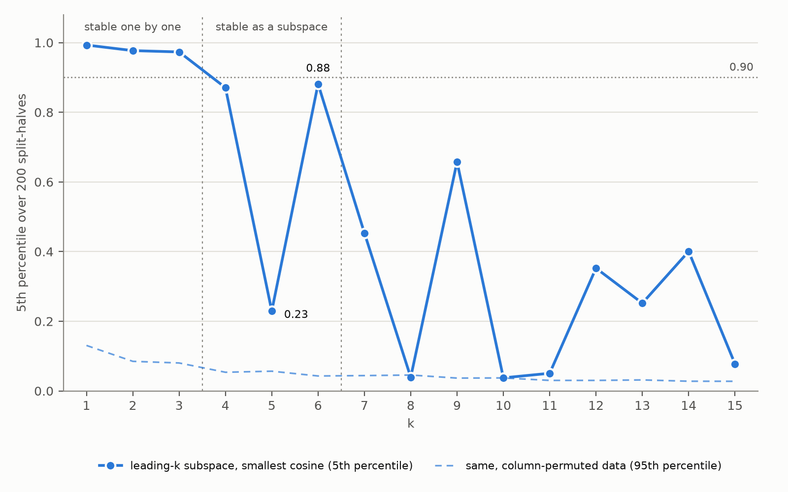

## 1. Introduction

Research on which occupations artificial intelligence might replace has rarely treated the question as multidimensional. Most studies draw on a range of underlying data and then collapse it into a single index of how substitutable each occupation is by AI relative to others. (A note on terminology: this paper avoids the term "exposure", which leaves open whether what is measured is substitution or human–AI collaboration. "Substitution" is used throughout, except where another author's measure is named.)

A single index cannot represent the fact that whether AI can substitute for human labour in an occupation is decided by several factors at once, and that these factors need not point in the same direction. Software engineering is a case in point. Some of the work is highly structured and can be handled by current systems without scaffolding, so it is readily substitutable. Other parts are context-rich, require planning and still depend on experienced engineers. Whether a given piece of software engineering is replaced by AI therefore depends on the balance between two opposing forces, which no single number can show. Studies that capture different factors reach opposite conclusions, which is one reason research on AI substitution remains contested and hard to reconcile, even where individual measures fit observed data well.

This paper attempts to identift the factors that bear on whether an occupation can be substituted by AI, and characterises each of them. A single index has one real advantage: it is easy to read, whereas a model with many variables is not. We keep that advantage by recovering a low-dimensional space of occupational characteristics, in which every occupation has a position on each axis. Two- and three-dimensional slices of this space can be drawn, so that policymakers can read off where each occupation stands while seeing the question in its full complexity.

This paper further seeks to identify labour-market variables, beyond the characteristics of the work itself, that may impede substitution, such as union density and occupational mobility. Published measures of AI exposure score only the content of the work and often leave such variables out. These variables bear on whether AI replaces workers or works alongside them, help explain the gap between measured substitutability and observed employment outcomes, and give policymakers concerned with employment stability something to act on.

The result is a six-dimensional description of occupational structure, with four labour-market variables that lie outside it. Three major dimensions — physical intensity, judgement and person-facing work — account for more than half of the variation among occupations, and three minor ones — manipulation against navigation, work with a fixed correct standard against open-ended work, and commercial against specialist work — add a further 10 percent. The four labour-market variables are union coverage, education and training requirements, self-employment and employment size. The dimensions are stable across a range of analytical settings, and their meanings are checked against O\*NET's own taxonomy. We treat each dimension as a factor in AI substitution and combine the six into a coordinate system in which occupations, and the substitution measures built on them, can be located and viewed in two- and three-dimensional slices.

## 2. Method

The most direct way to identify the factors governing whether AI can substitute for human labour in an occupation would be to measure AI performance on tasks representative of that occupation, and to combine those measurements with data on the occupation itself. The most advanced work of this kind is GDPval (Patwardhan et al., 2025), in which practitioners drawn from the occupations concerned both set the tasks and graded the results.

Where such measurement is not available, two practices are common. One is to score AI performance directly on a rating scale; the other is to ask a generative model which tasks it could perform. Both yield occupation-level numbers at low cost, but neither produces a quantity that can readily be verified against an external standard, and results of this kind have been shown to vary with the model performing the rating and with the phrasing of the prompt. We have neither the resources to commission expert assessment on the scale GDPval required, nor any wish to introduce judgements of our own in its place.

We therefore restrict the analysis to the demand side. We take the occupational feature data published in O\*NET, together with a set of labour-market variables attached to occupations, and recover from them the principal factors along which occupations differ. No measurement of AI enters at any point.

A considerable body of work has examined the structure of the O\*NET occupational space. However, all of that work relies on prior assumptions. Some have fixed the number of dimensions in advance, according to an economic theory to be tested or to the external data the result was to be matched against; the theory is then confirmed, but the structure of the data itself is left unexamined. Some transform the input before analysis — binarising continuous ratings, for instance — which may sharpen or weaken the structure that emerges and introduces a particular bias, even where the validity of the final result is unaffected. Others build weighted aggregates in which the weights are heuristic and cannot be verified against anything, although the resulting indicator may still point in broadly the right direction.

We take an alternative approach. We apply unsupervised analysis — clustering and
principal component analysis — directly to the published feature ratings, with no
structure specified in advance, in order to recover the shape of the space
itself; everything that follows is conducted on the structure so obtained.

The purpose of proceeding this way is to let the data tell the story. A
structure fixed in advance can only be confirmed or rejected; one recovered from
the data can also be surprising, and the surprises are where the contribution
lies. We therefore treat each axis the decomposition returns as a claim to be
checked against what is already known. Where the recovered structure reproduces a
distinction the literature already draws, that is evidence for the distinction,
arrived at without having assumed it, and it is also evidence that the procedure
has found structure rather than noise. Where the recovered structure cuts across
the received account, we take the discrepancy as the finding rather than
smoothing it over: we ask which of the two the data supports, what the received
account was tracking instead, and what follows for how substitution should be
measured.

### 2.1 What this design cannot do

Two consequences follow, and we state them plainly.

The first is that this paper doesn't contain strict evidence about what AI can or cannot do. What it offers is a framework — an account of which variables bear on the question and of the space those variables form — rather than an estimate of substitution risk for any occupation. The function mapping a position in that space to a probability of displacement is not estimated here; the paper fixes the arguments of that function and leaves its coefficients to work that can measure capability.

The second consequence is a compensating one. Capability estimates have a short shelf life and must be revised as systems improve, whereas the structure of occupational features changes far more slowly, and the axes along which occupations differ are likely to remain interpretable across successive revisions of any capability measure. A framework specified on the demand side can therefore accommodate new capability evidence without being rebuilt. We would not claim that occupational requirements are fixed — they are themselves reshaped by technology, and O\*NET revises its ratings accordingly — only that they move on a slower timescale than the capabilities being measured against them.

The cost is equally plain. An analysis conducted on this side of the problem cannot say which occupations are most substitutable at any given moment, and cannot be updated to track a changing frontier. What it can do is establish the terms in which such a judgement would have to be expressed.

A further limitation runs deeper than the absence of capability measurement. The requirements an occupation places on a human worker are not necessarily the requirements it places on an AI system. Capabilities that are distinct for people may be a single capability for a model — O\*NET treats law, medicine and marketing as separate knowledge elements because each is acquired through separate and lengthy human training, whereas for a model trained on a broad corpus these are closer to one capability applied at differing densities of training data. Conversely, work that makes almost no demand of a person, such as playing through a game to test it, may lie beyond what current systems can do. There is no reason to expect the dimensions along which human requirements vary to coincide with the dimensions along which machine difficulty varies, and a space recovered from human requirements may therefore organise capability evidence only loosely once such evidence is introduced.

We note that this difficulty is not specific to the present paper. No study to date has recovered the structure of AI capability empirically in the way that occupational features have been recovered here; capability is generally represented either by a single index or by a set of domains specified in advance. Until the capability side has a measured structure of its own, the correspondence between the two spaces cannot be assessed in either direction. We record this as a limitation of the approach and as an open question for the field, rather than as one this paper resolves.

## 3. Literature

**Measures of substitution.** A first generation established that the question could be quantified and fixed O\*NET as the substrate for almost everything since (Frey and Osborne, 2017; Brynjolfsson et al., 2018; Felten et al., 2018, 2021; Webb, 2020 [WP]). Capability was inferred indirectly — from patent text, from benchmark results, from crowd-sourced matching to ability scales — and aggregated to occupations by weights the authors judged reasonable. Each produced a single score. Their disagreement is the relevant fact here: correlations of these measures with wages run from −0.56 to +0.54, so they are not noisy estimates of one quantity but estimates of different ones. The approach has not been superseded so much as left available: independent work continues to appear in which both the task scores and the aggregation weights are assigned by the author, validated against external data but leaving no structure a reader can test (for instance, 2026 [WP]).

A second generation made the capability judgement explicit and reproducible. Eloundou et al. (2024) apply a common rubric to O\*NET task statements, separating what a model can do unaided from what it can do with additional software, and report inter-rater agreement. Work in this group also began to set the resulting scores alongside the characteristics of the workers holding the occupations: the Pew Research Center's analysis (Kochhar, 2023) scores O\*NET work activities and skills, matches 873 detailed occupations to 485 in the Current Population Survey, and crosses the result with wages, education, gender, race and industry, finding the most exposed occupations paying \$33 an hour against \$20 in the least exposed; the US Treasury (2024) analysis follows a similar route. These are the closest precedents for the second question asked here, though they describe the labour-market characteristics of exposed occupations rather than asking whether those characteristics carry information the feature data does not. The capability side improves throughout; the output remains one number per occupation.

Frontier work advances on one of two fronts. GDPval (Patwardhan et al., 2025 [WP]) measures rather than judges: practitioners author the tasks and grade the deliverables. Its coverage is correspondingly bounded, since a task must yield a reviewable artefact, which excludes most embodied work by construction. The OECD (2026 [WP]) advances instead on structure, assessing AI capability and occupational demand separately on a common five-level scale across nine domains and publishing the gap for each domain as well as the total. That measure is the closest in spirit to the present paper, and its own caution is our point of departure: the total index "should be interpreted alongside the underlying domain-specific gaps rather than as a self-sufficient measure." Separately, the Anthropic Economic Index (Handa et al., 2025 [WP]) records what AI is actually used for rather than what it can do, and is the only public source distinguishing automative from augmentative use.

**The task framework.** Autor, Levy and Murnane (2003) organised this literature around two crossed distinctions, manual against cognitive and routine against non-routine; Deming (2017) established the wage return to social skills. Both bear on how the axes recovered below should be read, and Section 5.4 returns to them.

**Prior attempts to analyse the structure of O\*NET.** Alabdulkareem et al. (2018) analysed O\*NET with the skills as objects rather than the occupations. They normalised the occupation-by-skill matrix by revealed comparative advantage and binarised it, and found two communities — one social and cognitive, one sensory and physical. We follow that work in seeking structure rather than imposing it, and depart from it in two respects: we do not binarise, since thresholding discards the intermediate values that distinguish occupations differing by degree, and we take occupations rather than skills as the objects, because displacement attaches to occupations.

The closest methodological precedent is Lise and Postel-Vinay (2020), who run principal component analysis on over two hundred O\*NET descriptors, retain the first three components, and recombine them to satisfy three exclusion restrictions — that mathematics reflects only cognitive requirements, mechanical knowledge only manual, and social perceptiveness only interpersonal — stating that the resulting labels rest on those restrictions. The procedure is ours; the object is not. Their components are an input to a structural model of sorting, and the properties of the reduction are accordingly left unexamined. The number of components is fixed at three and no test of that number is reported, nor eigenvalues, variance shares, or any diagnostic of stability; the authors note that for a one-dimensional variant of their model they remain agnostic as to what the first principal component measures. The estimation is run on a worker-week panel of a single survey cohort, so occupations enter weighted by employment and occupations nobody in that cohort held are absent; the Level rather than the Importance scale is used; and descriptors that could not be assigned in advance to one of the three target concepts are dropped before the decomposition. Each of these is appropriate to their purpose and consequential for ours. Benzell et al. (2019 [WP]) reach eight factors on similar data by pruning items until each loads cleanly on one factor. Neither tests whether the reported components reproduce on an independent subset of occupations.

**Labour-market position.** Whether a technically feasible substitution is carried out depends on more than capability, and a separate literature has established that the relevant variables are neither negligible nor recoverable from the content of the work. Svanberg et al. (2024 [WP]) find that cost and firm size leave most technically automatable vision work unattractive to automate, with the binding constraint being that most firms are too small to justify the fixed cost. Weeden (2002) maps five institutionalised closure devices — licensing, educational credentialing, voluntary certification, association representation and unionisation — onto 488 occupations, and finds that the returns to them are not tightly linked to the complexity of the occupation's knowledge base: institutional position and occupational content are largely separate things, which is the proposition our treatment of the labour-market variables assumes and tests. The direction of the institutional effect on substitution, as distinct from wages, is unsettled. Collective agreements may restrain what an employer does with a technology, but by attaching rents to a job they may equally invite its automation (Acemoglu and Restrepo, 2024), and minimum wage increases have been shown to accelerate the automation of automatable work (Lordan and Neumark, 2018). We therefore treat these variables as a dimension to be located rather than as a protective factor to be assumed.

**Mechanisms below the occupation.** A further literature works at the level of tasks within a job, and it is precisely the level our data cannot reach, since O\*NET publishes one profile per occupational code. Autor and Thompson (2025) show that when tasks are automated the sign of the wage effect depends on whether the removed tasks were the expert or the inexpert part of the job: automation that strips away inexpert tasks raises wages and lowers employment, and automation that strips away expert tasks does the reverse. A share-of-tasks-exposed measure therefore cannot determine the direction of the effect, however accurately it is estimated. Freund and Mann (2026 [WP]) reach a compatible conclusion from task bundling, and report that dispersion of outcomes within an occupation grows with its exposure, so an occupational average is least informative exactly where exposure is highest. Hampole et al. (2025 [WP]) find that occupational outcomes are summarised not by one statistic but by two, the mean of task exposure and its concentration, which offset one another. We record these results as a limit on what any occupation-level description can deliver, and return to them in Section 6.

**Observed outcomes.** The clearest employment evidence to date is not of displacement. Brynjolfsson et al. (2025 [WP]), using a monthly payroll panel of several million US workers, find no widespread economy-wide job losses, but report that employment of workers aged 22 to 25 in the most exposed occupations stands well below where it would be had it kept pace with their less exposed peers, with no comparable gap for experienced workers. The adjustment runs through reduced hiring rather than increased separations — separation rates in exposed occupations fell at least as fast as elsewhere — and the declines concentrate in occupations where AI usage substitutes for labour rather than complementing it. The authors present these as descriptive facts rather than causal estimates, and note that the estimates attenuate when occupational education is controlled for, that some divergence predates the technology, and that their sample over-represents large firms and exposed occupations. Others reach different conclusions on different data: Humlum and Vestergaard (2025 [WP]) find no significant effect on earnings or hours in Danish administrative data, and Lambert and Schindler (2026 [WP]) attribute much of the entry-level pattern to remote work. Two features of this evidence bear on what follows. The signal is a within-occupation one, at the entry level, which is the level our data cannot represent; and it is about hiring rather than employment stocks, which is the margin on which institutional protection of incumbents would be expected to leave occupational totals unchanged.

## 4. Data

### 4.1 O\*NET and the data we use from it

The analysis needs two kinds of data: features of the occupations themselves,
and the position each occupation holds in the labour market. O\*NET is our
largest single source. This section introduces it briefly and sets out which of
its data we use. Section 4.2 describes in more detail how we prepare the
occupational features, and Section 4.3 how we obtain the labour-market
variables, most of which O\*NET does not contain.

O\*NET is the successor to the *Dictionary of Occupational Titles*, maintained for
the US Department of Labor. It describes roughly nine hundred detailed
occupations on several hundred numeric scales, rated by job incumbents surveyed
within each occupation, by occupation experts and by trained occupational
analysts. We use release 31.0, published in August 2026. Its organising scheme,
the Content Model, is arranged in three parts — the worker, the job and the
market — each divided into areas, and the areas into the blocks of descriptors
that O\*NET publishes (Figure 1).

```{=html}
<figure class="content-model">
  
  <figcaption><b>Figure 1</b> — the O*NET® Content Model. Source: National Center
  for O*NET Development, O*NET Resource Center. Used under the CC BY 4.0
  license.</figcaption>
</figure>
```

We take the blocks in turn, quoting O\*NET's definition of each and saying
whether we use it and why. The definitions are quoted from O\*NET OnLine or,
where it gives none, from the Content Model page of the O\*NET Resource Center
(National Center for O\*NET Development, n.d.-a, n.d.-b). Five blocks enter the
feature matrix.

**Abilities.** "Abilities are enduring attributes of the individual that
influence performance." The ratings are made by trained occupational analysts
for every occupation. O\*NET groups abilities into cognitive, psychomotor,
physical and sensory. The block is a direct rating of the capacities an
occupation demands, and so bears directly on which capacities a system would
need in order to do the work.

**Skills.** The Content Model lists three kinds. "Essential skills are skills
you need for most jobs, such as reading, writing, math, and learning";
"transferable skills are skills you can use across different jobs, such as
communication, problem solving, and team work"; and software skills are "using
specific programs and applications for work tasks." Trained occupational
analysts rate the essential and transferable skills of every occupation;
together they hold thirty-five elements, which we use as one block. Where an
ability is enduring, a skill is
acquired, which bears on how quickly an occupation could be re-staffed or its
workers retrained if part of the work were automated. Software Skills are
recorded differently: as examples of software linked to each occupation, flagged
where employer job postings frequently ask for them, but not rated. They are not
used in the present analysis.

**Knowledge.** "Knowledge is organized sets of principles and facts applying in
general domains." The ratings come from a survey of incumbents for about 72
percent of the occupations analysed here, from occupation experts for about 27
percent, and, for the remaining nine, from provisional analyst ratings that
O\*NET publishes until a survey is completed. There are thirty-three domains, from administration and
management to law, medicine and engineering. The block bears on substitution
with a caveat we state rather than resolve: what O\*NET treats as separate
domains, because each takes a person years to acquire, may not be separate for a
model trained on a broad corpus. It still discriminates occupations well, which
is what it is used for here.

**Work Activities.** "Work activities are general types of job behaviors
occurring on multiple jobs." The raters are the same as for Knowledge. O\*NET
groups them into information input, mental
processes, work output and interacting with others. We use the general level,
the forty-one activities rated for every occupation; the intermediate and
detailed levels below it classify task statements and are not rated. Of the
five blocks this is the closest to what is actually done rather than to what the
doer is like, and it is therefore the block most directly comparable to the
task-level measures the substitution literature is built on.

**Work Context.** "Work context is physical and social factors that influence
the nature of work." The raters are the same as for Knowledge. O\*NET groups
it into interpersonal relationships, physical
work conditions and structural characteristics of the job, such as its pace and
the consequences of its decisions. It carries what the other blocks omit:
whether the work is done in person, outdoors, under hazard, under time pressure,
in contact with the public. These constrain what can be delegated to a system
independently of how difficult the work is, and without this block an
occupation's physical setting is invisible to the analysis.

The other blocks are not used, for reasons that differ in kind.

**Career Interests and Work Styles.** Career Interests comprise Career Interest
Types, "broad types of work you enjoy", and Specific Interest Areas, "work
activities you enjoy"; "work styles are personality tendencies exhibited at
work, which can affect how well someone performs a job." Both describe what suits
a person rather than what the work requires, and both are excluded because they
are not observations. O\*NET produces Work Styles and Specific Interest Areas by
what it calls a hybrid artificial intelligence–expert method, and Career
Interest Types by a machine learning–expert method. They are model outputs
rather than measurements of the occupation, and including them would put a
model's judgement inside a matrix intended to hold only measured features.

**Occupation-Specific Info.** "Details about a specific job": each occupation's
title, description, job titles and tasks, where "tasks are specific work
activities that can be unique for each occupation." This is descriptive text
that documents an occupation for reference rather than measuring it, and it is
not used.

**Education, training, experience and licensing.** Education is the "education
typically required to perform a job", Experience and Training "the amount of
related work experience and training needed for a job", and Licensing the
"required licenses, certifications, or registrations needed to perform a job."
O\*NET publishes education, training and experience as the distribution of
answers given by respondents in each occupation; for licensing, the nearest
measures in the database are two importance ratings, of a job-related
professional certification and of an apprenticeship. We take the view that this
group is not a description of the work, and introduce it in Section 4.3 with the
other labour-market variables and the market part of the Content Model; Section
5.5 gives the evidence that led us there.

### 4.2 Scales and missing values of the occupational features

O\*NET publishes most of the blocks we keep on more than one scale, so the first
choice is which to keep. Work Context is the simpler case. Each of its 55 rated
items has five ordered categories, from "never" to "every day" or from "not
important at all" to "extremely important", which add up to 100%, and O\*NET publishes both the
percentage of respondents in each category (CXP) and their weighted mean, the
Context rating (CX). CX holds most of what the percentages
hold, it explains a median of 71 percent of the variance of the category percentages across occupations.
Using all the percentages would distort the matrix. Even with one category per item dropped, since the
five sum to 100, they make 220 columns, more than the other four blocks
together, and Work Context would dominate the variance. Weighting them down
would prevent that, but no criterion fixes the weight. It would have to be set
by rule of thumb, and the choice would bias the result in a direction of its
own.

Two further Work Context items are not rated on the Context scale: Duration of
Typical Work Week (less than 40 hours, 40 hours, more than 40) and Work
Schedules (regular, irregular, seasonal). O\*NET publishes them as category
percentages (CTP) and as a mean category (CT). Here the mean is no summary.
Work Schedules is a nominal item, so the mean of its category codes has no
meaning, and the mean of Duration cannot tell an occupation of part-time and
long-hours workers from one in which everyone works forty hours. We use the
percentages, leaving out the standard category of each item, 40 hours and
regular, since the three sum to 100.

Four of the blocks — Skills, Abilities, Knowledge and Work Activities — are
published on two scales at once. Importance records how consequential a
descriptor is to the occupation; Level records how much of it the work demands.
Retaining both would be the natural default, and the four blocks would then
occupy 322 columns rather than 161. We retain Importance only, for three
reasons, in order of weight.

The first is precision. A Level rating is far more often too imprecise to use
than the Importance rating of the same element. O\*NET marks such ratings with a
Recommend Suppress flag: for survey data when fewer than ten people responded,
when fewer than fifteen responded and all gave the same answer, or when the
standard error exceeds half the rating itself; for analyst data when the
standard error exceeds 0.51. In release 31.0 the flag falls on 6,168 of the
146,551 Level rows in the four blocks, and on 69 of the same number of
Importance rows. It is concentrated where the analysis would feel it most:
16.3 percent of Knowledge Level ratings are flagged, against 0.2 percent of
Knowledge Importance ratings, and 2.9 percent of Work Activities Level ratings,
against almost none on Importance. Keeping Level would put several thousand
ratings that O\*NET itself recommends withholding into the matrix.

The second is meaning. O\*NET also marks a Level rating Not Relevant when the
element barely matters to the occupation: when more than three quarters of
incumbents rate its importance as "not important", or when no more than two of
the analysts rate its importance 2 or higher. The flag falls only on Level rows:
on 16 percent of them in Abilities, 11 percent in Skills, 20 percent in
Knowledge and 3 percent in Work Activities. A flagged rating still carries a
number, at or near the bottom of the scale — the median is 0 in Abilities and
0.34 in Knowledge — but O\*NET advises showing users that the level is not
relevant rather than showing the number. It is therefore neither a measurement
the publisher stands behind nor a missing value, and the data offers no ground
for preferring one treatment of it over another, whether the published number,
zero, or a gap.

The third is redundancy. Across the 161 elements, an element's Importance and
Level correlate across occupations at a median of 0.94, and above 0.9 for three
quarters of them; the whole Level matrix can be predicted from the Importance
matrix by cross-validated ridge regression at R² = 0.90. Level would almost
double the width of the matrix for about a tenth of new information. Appendix A
reports what the analysis gives when Level replaces Importance and when the two
are used together.

**Missingness.** Of the 1,016 O\*NET-SOC codes that release 31.0 lists, 105 have
no ratings in any block and one is rated in only two of the five; every other
occupation is complete in all five blocks, apart from nine that lack the
working-time percentages (see below). Missingness in the feature data is therefore
almost entirely a matter of whole rows, and what
needs explaining is which rows are absent and why. The composition of the 105
is not arbitrary, and the SOC coding system itself identifies most of it.

Ninety-four of the 105, or 89.5 percent, are not occupations in the sense the
survey needs. Seventy-four are artefacts of the classification. The SOC
reserves, within each broad group, a detailed code whose four-digit portion ends
in 9 for the "All Other" residual: `51-3099`, `43-4199` and the like collect the
scattered jobs that belong to a group without warranting a line of their own. A
residual bucket is heterogeneous by construction, so there is no coherent
occupation for O\*NET to survey and it does not survey one. The military major
group, `55-xxxx`, nineteen codes, is likewise outside the civilian survey frame
in its entirety. The last is legislators, who are elected rather than employed.
Dropping these is not a judgement about which occupations matter but the absence
of anything to measure.

The remaining eleven are ordinary detailed occupations, created or split in the
2018 SOC revision, which O\*NET's rolling survey has not yet reached; emergency
medical technicians, separated from the former combined code for technicians and
paramedics, are an example. Their descriptor rows are empty because collection
has not caught up, not because the occupations are marginal. A twelfth code from
the same revision, calibration technologists and technicians, is rated on Work
Activities and Work Context but not on Abilities, Skills or Knowledge.

We drop these rows rather than fill them. A code is split off because its work
differs from that of the code it came from, and the parent is the only donor
available; filling the new occupation from it would write that difference back
out of the data and introduce a large bias into exactly the occupations
concerned. Scattered gaps could be filled from a column median or a neighbouring
occupation, with little at stake in any one cell, but an occupation with no
measurements at all leaves nothing to anchor a fill. The loss is also small:
twelve of the 922 ordinary detailed occupations, 1.3 percent.

**910 detailed occupations remain, and this is the analysis set throughout.**
Their 220-column feature matrix is complete as published, with one exception:
nine occupations have Work Context ratings but no category percentages, so
their four working-time columns, 36 cells in all, take the column median. These
are the only imputed feature values. The few Importance and Context ratings
that O\*NET flags for low precision, 69 and 121 rows respectively, are kept as
published.

The matrix is wide for its length, 910 occupations against 220 variables, and
the methods are chosen with that in mind. The ratings are heavily collinear, so
the effective dimension of the matrix is far below 220 (Section 5.3), and what
the width costs depends on the method. For principal component analysis it
costs little: the estimand is the covariance structure rather than a set of
coefficients, and collinearity concentrates that structure in a few directions.
For clustering, many dimensions can blur distances until every occupation looks
about equally far from every other, hiding groups that exist; Section 5.2 rules
this out by repeating the clustering on the leading ten components. For
regression, the width does bite. With 220 predictors against 910 observations,
ordinary least squares fits the training folds almost exactly and generalises
arbitrarily, returning large negative cross-validated R² values. The regressions
of Section 5.6 therefore use ridge, whose penalty is what makes the estimate
meaningful in this shape, with the scaler fitted inside each fold.

The final matrix, of 910 occupations, is as follows.

| block | scale | columns | missing cells | filled |
|---|---|---|---|---|
| Work Context | Context | 55 | 0 | none |
| Work Context (working time) | Category percentages | 4 | 36 | column median |
| Abilities | Importance | 52 | 0 | none |
| Work Activities | Importance | 41 | 0 | none |
| Skills | Importance | 35 | 0 | none |
| Knowledge | Importance | 33 | 0 | none |
| **Total** | | **220** | **36** | |

: The final matrix {#tbl-final-matrix}

### 4.3 The labour-market variables

The Content Model already has a place for the labour market. Its third part,
the **Market** — labour market information and occupational outlook — sits beside
the worker and job descriptors of Section 4.1, which is O\*NET's own statement
that where an occupation stands in the labour market belongs to the description
of it. What that part does not have is data of its own. The downloadable
database distributes no file for it. O\*NET OnLine fills it at display time from
the Bureau of Labor Statistics, under the line "Source: Bureau of Labor
Statistics 2025 wage data and 2024–2034 employment projections", and shows
four national figures: a median wage, an employment count, a growth rate
reported as a band, and a count of projected openings.

Going to those sources directly is therefore not a departure from O\*NET's
scheme but the same numbers at the resolution the question needs. A median wage
cannot say whether pay within an occupation is tightly or widely spread. A
single growth band cannot separate workers who leave the labour force from
workers who move to another occupation, and Section 5.6 turns on that
distinction.

Each variable is taken in turn — why it might bear on whether a technically
feasible substitution is carried out, where the numbers come from, whether their
coding lines up with O\*NET's, and what is missing from them.

**Education, training and experience** *(O\*NET, Worker and Experience
Requirements, incumbents or occupation experts).* This is the one variable here
that O\*NET itself collects: for each occupation, the share of respondents
reporting each ordinal level of required education, prior related work
experience, on-site or in-plant training and on-the-job training. It sits in
this section rather than in Section 4.1 because, in our reading, it does not
describe the work but what holders of the job have — which is where
credentialing and licensing enter the data. Entry thresholds are institutional
rather than technical and can hold even where the work is substitutable, and a
licensed occupation with a substitutable task profile is exactly the case the
paper wants to be able to see. Section 5.6 supplies the empirical half of the
argument: what preparation an occupation demands is not recoverable from what
the work requires. Because the block is O\*NET's own, no join is needed. Since
release 30.3 it is published as two files, Education and Training and
Experience.

The education scale needs one further step. Release 31.0 publishes required
education on two scales: RL, the scale of earlier releases, for 758 of the
occupations analysed, and RQ for the other 143, never both for one occupation.
RQ appears only among occupations whose education data were collected for this
release, and its category labels are the response options of the Education and
Training questionnaire as revised in February 2025. Its twelve categories match
RL's in number and order. Ten are worded identically; two are reworded, First
Professional Degree becoming Doctor's Degree, Professional Practice (such as a
J.D. or an M.D.), and Doctoral Degree becoming Doctor's Degree,
Research/Scholarship (such as a Ph.D.). We merge the two scales category by
category into one. The evidence that this is safe comes from the 121
occupations that were on RL in release 30.2 and are on RQ in 31.0. Their mean
education level moves by −0.08 of a category, with a standard error of 0.07,
and their distributions move no further than the training and experience
distributions of the same occupations, which stayed on unchanged scales: a
median distance of 0.29 against 0.35. One change is systematic. The share in
category 10 falls from 1.4 percent to zero once the category is described as a
doctorate rather than a first professional degree; post-secondary certificates
and some college courses also lose about two percentage points each, at about
two standard errors. We record these rather than correct for them.

Nine of the 910 occupations have no rows in either file: 333 cells, absent as a
whole block rather than scattered. They are the nine whose descriptor ratings are
still provisional analyst ratings, which come without the respondent
distributions this block reports. No cell is missing anywhere else. Two further
items in these files, the importance of a job-related professional certification
and of an apprenticeship, are published for only 683 of the 910 occupations and
are not used.

**Wages.** The wage is the price of the labour a substitution would replace,
and so sets the return to replacing it; the spread of wages within an occupation
indicates whether the code holds one job or several, which bears on whether an
occupation-level substitution measure means anything for the people in it. We
take the national May 2024 Occupational Employment and Wage Statistics: mean,
median and the tenth, twenty-fifth, seventy-fifth and ninetieth percentiles of
annual pay. OEWS keys on the six-digit SOC, which maps one to one onto
O\*NET-SOC codes once the decimal extension is truncated, so the join loses no
information; where several O\*NET variants share a six-digit code — the
specialisms under Physicians, for instance — each variant receives the same
value, which is a property of the published data rather than of our handling.
Coverage is 96.2 percent at the tenth percentile and falls to 90.5 percent at
the ninetieth, and the two causes of that gap are different in kind.

Thirty-five occupations have no annual wage figure of any kind. They do not look
like a random thirty-five: they arrive in families — the three buyers and
purchasing agents codes, the two appraisers codes, the two counsellor codes, two
special education teacher codes, the six clinical laboratory technologist and
technician codes, home health aides with personal care aides, the two teaching
assistant codes, tour guides with travel guides, three assembler codes, three
first-line supervisor codes — which is the signature of OEWS publishing at a
broader SOC line than the one O\*NET rates. Four of the thirty-five are different
again: actors, dancers, musicians and singers, and disc jockeys outside radio
have an OEWS employment figure but no annual wage, work in those occupations
being too irregular for an annual figure to be published.

The second cause is top-coding, and it runs the other way: the occupation is in
OEWS and the value is suppressed because it exceeds the cap OEWS places on
annual wages, \$239,200. The suppression is nested and tells its own story about
the top of the distribution. The ninetieth percentile is suppressed for
fifty-one occupations — chief executives, most managerial codes, lawyers,
physicists, airline and commercial pilots, the dental and physician
specialisms; the seventy-fifth for twenty-five, by which point the managers are
down to the two chief executive codes and almost everything left is medicine;
and the median for eighteen, all of them physician or dental specialisms, where
more than half of all holders earn above the cap. Missingness of this kind
carries information: it states that the true value lies above \$239,200.

**Employment.** Employment is the scale of any displacement, and it is also a
control: a substitution measure that correlates with occupation size may be
measuring size. It comes from the same OEWS release and joins the same way.
Thirty-one occupations have no employment figure, and they are the same
occupations that have no wage, less the four — actors, dancers, musicians and
singers, and disc jockeys — for which OEWS reports employment but not annual
pay.

**Union coverage.** A collective agreement can constrain what an employer may
do with a technology irrespective of what the technology can do, which makes
union coverage the clearest case of an institution standing between technical
feasibility and observed displacement. We take the share of employed workers
covered by a union contract from the 2024 Current Population Survey. This is the
one variable whose coding does not line up. The CPS occupational classification
is coarser than the SOC: roughly 450 distinct CPS classes back the 880 O\*NET
occupations that can be matched, so the value is broadcast, and groups of
occupations share a coverage rate. Broadcasting does not bias the value, but it
attenuates any correlation the variable takes part in, and it means the number
should not be read as a statement about the unionisation of a single
occupation. The join runs through the BLS National Employment Matrix crosswalk.
Thirty occupations cannot be matched through it, so coverage is 96.7 percent;
they are the same thirty that are absent from the projections tables below.

**Occupational prestige.** Social standing may protect an occupation
independently of its technical content. We take the Occupational Prestige Ratings project.
Several rated job titles can fall under one six-digit SOC, and where they do the
ratings are averaged. Fifty-four occupations are unrated, almost all of them
detailed management titles the project did not cover; coverage is 94.1 percent.

**Separation rates.** How readily workers leave an occupation says how far it
can shed labour without dismissals, which is where displacement has in practice
been observed first, and the two ways of leaving are not the same event. We take
both from table 1.10 of the BLS Employment Projections: the labour-force exit
rate, the projected annual share of workers who leave employment altogether, and
the occupational transfer rate, the share who move to a different occupation.
The table keys on the six-digit SOC. Thirty occupations are absent from it;
coverage is 96.7 percent for both.

**Self-employment.** Where the work is done by the self-employed there is no
employer to make the substitution decision, so the mechanism by which a
technology displaces labour is different in kind rather than weaker. We take the
self-employed share from table 1.2 of the same projections release, on the same
six-digit key. Blanks in that table denote negligible self-employment rather
than an unmeasured quantity, and are read as zero. The same thirty occupations
are absent from this table altogether, and are also set to zero; for them this
is an assumption rather than a reading of the source.

Three further variables are published in the same sources and are not carried
into the analysis, for reasons that are worth recording because two of them are
about redundancy rather than quality. **Occupational openings** correlates 0.89
with employment, so the two are close to one measurement of occupation size;
Section 5.6 is where questions of that kind are settled, and admitting both
there would give size two votes in a regression that has one variable per
mechanism. **Typical education needed for entry**, the BLS categorical
threshold, is recoverable from the ETE distributions at R² = 0.82, and the ETE
distributions are the finer instrument. **Work experience needed** is populated
for only about one occupation in eight and cannot support an analysis at all.
Projections of employment growth to 2034 are excluded on a different ground:
a forecast of an occupation's growth may already embed a judgement about
automation, so relating it to a structure intended to inform such judgements
would be circular.
<!-- TODO (31.0): the 0.89 (openings vs employment) and R2 = 0.82 (typical
education from ETE) were computed on the release 30.2 set. Neither openings nor
typical education is carried into master_31_0.csv, so they need the BLS
projections file; recompute on the 910 occupations. -->

The sources were collected at different dates, and the analysis treats them as
one period. Wages and employment are from May 2024, union coverage from the 2024
CPS, the separation rates are projected annual averages for 2024–34, and the
prestige survey is earlier still — while O\*NET itself revises its blocks on a
rolling schedule, so that different occupations carry different vintages within
the feature matrix as well. This is an approximation, and it is the kind a
cross-sectional design cannot avoid.

**Imputation.** Because the causes of the gaps differ, the treatment differs,
and all of it happens in one script so that every analysis reads the same
numbers. Where a high wage percentile is missing while a lower one is present,
the occupation is in OEWS and the value has been suppressed above the cap; it is
filled at the cap, \$239,200. Filling it at the column median would place a
surgeon below their own tenth percentile, which is not a conservative choice but
an incorrect one. Ninety-four cells are filled this way. Where every wage
percentile is missing the occupation has no anchor, and the six cells take the
column median: 210 cells across the thirty-five occupations. The three wage
ratios are then recomputed from the filled levels rather than filled directly,
which keeps them consistent with the levels and no less than one.
Self-employment is set to zero as described above. Everything else — the unrated
prestige scores, the missing union coverage and separation rates, the nine ETE
rows — takes the column median.

Three considerations bound the risk this introduces. The variables carrying most
of the imputation, the wage percentiles, are compressed to two summary columns
before they are used, so the imputed cells are diluted before they reach any
estimate. None of these variables enters the decomposition at all, so no
imputation decision can be producing the axes. And the imputation is confined to
one step rather than repeated in each script. What it cannot be defended against
is a systematic difference between the occupations a source omits and those it
covers: the median fill assumes absence is uninformative, and for the
thirty-five occupations with no OEWS wage we have no evidence either way.

Standardisation is deliberately not applied at this stage. The ridge regressions
of Section 5.6 fit their scaler within training folds only, and storing
standardised values would carry test-fold information into the training set.

**Transformations.** Three are applied before any variable in this section is
used. Employment spans several orders of magnitude, with a maximum sixty-seven
times its median, and enters as a logarithm. Wages enter as two summaries rather
than nine percentiles — the log of the median as a level, the ninetieth-to-tenth
ratio as a dispersion — because nine near-collinear measurements of one quantity
would otherwise give that quantity nine votes against one for every other
variable. And the highest category of each education, training and experience
scale is dropped, because the categories of a scale sum to 100 and one is
therefore linearly determined by the others; this removes an exact collinearity
and takes the block from 41 columns to 37.

::: {.lm-table}

| variable | why it might bear on substitution | source | what the coding does | coverage and treatment |
|---|---|---|---|---|
| education, training and experience | entry thresholds are institutional, not technical, and can hold where the work is substitutable | O\*NET 31.0, Education and Training and Experience | already on O\*NET-SOC; no join; the RL and RQ education scales merged category by category | 9 occupations absent as a whole block (333 cells) → column median; highest category of each scale dropped, 41 → 37 columns |
| wage level and dispersion | the price of the labour sets the return to replacing it; spread says whether the code holds one job or several | OEWS national, May 2024 | exact on the six-digit SOC; O\*NET variants of one code share a value | 90.5–96.2% by percentile; 94 top-coded cells → the \$239,200 cap, 210 whole-row cells → column median; enters as log median and p90/p10 |
| employment | the scale of any displacement, and a control against measuring occupation size | OEWS national, May 2024 | exact on the six-digit SOC | 96.6%; column median, then logged |
| union coverage | a collective agreement constrains what an employer may do irrespective of what is possible | CPS 2024, via the BLS National Employment Matrix crosswalk | broadcast: ~450 CPS classes to 880 occupations | 96.7%, at reduced resolution; column median; attenuates any correlation it enters |
| occupational prestige | status may protect an occupation independently of its content; also a check on whether an axis is a status measure | Occupational Prestige Ratings project | averaged where several rated titles share one SOC | 94.1%; column median |
| labour-force exit rate; occupational transfer rate | how readily an occupation sheds labour without dismissals, and whether leavers exit or move | BLS Employment Projections, table 1.10 | exact on the six-digit SOC | 96.7%; column median |
| self-employment share | no employer to make the substitution decision, so the mechanism differs | BLS Employment Projections, table 1.2 | exact on the six-digit SOC | 96.7%; blanks mean negligible and the 30 absent occupations are assumed so, both set to zero |

: The labour-market variables {#tbl-labour-market}

:::

None of these variables enters the decomposition. They are the subject of
Section 5.6, which asks how much of each the feature data can predict, and which
explains there why that question is put to a regression rather than to a
decomposition.


## 5. Analysis and results

### 5.1 Standardisation

Every variable is z-scored — its mean subtracted and the result divided by its
standard deviation — before entering any decomposition or clustering. Both
methods work on variance, so on unstandardised data a variable recorded in large
units would simply have more of it, and the leading component would report which
columns happened to be measured on a wide scale. Z-scoring is the standard
remedy and is not specific to this paper.

It matters more here than usual, because the columns are not on one scale: a
five-point importance rating and a percentage of respondents in an education
category are not commensurable in the first place. Z-scoring is a linear
transformation, so it moves and rescales a variable but leaves its shape, its
rank order and every correlation it takes part in unchanged; the distribution
the decomposition sees is the distribution O\*NET published, in common units.

Standardised matrices are not stored. Each analysis standardises its own, because
the cross-validated regressions of Section 5.6 must fit the scaler within
training folds only, and a matrix standardised once in advance would carry
test-fold information into every estimate built on it.

### 5.2 Do occupations fall into classes?

The reason to expect classes comes from Alabdulkareem et al. (2018), who find
two communities among skills — one social and cognitive, one sensory and
physical. If occupations fell into a few kinds, the substitution question
could be answered kind by kind — identify the exposed kinds — and the analysis
would be simpler. What follows asks the same question of occupations: do they fall into classes? We cluster the 910
occupations by k-means for k from 2 to 10 and measure separation by the
silhouette coefficient, which compares a point's average distance to the other
members of its own cluster against its average distance to the members of the
nearest other cluster. Values near 0.5 and above indicate separated groups;
values near 0.2 indicate a partition imposed on a continuum.

**Occupations do not form groups.** The best silhouette is 0.223, at k = 2, and
it falls as k rises. Repeating the test in the leading ten principal components,
in case distance concentration in 220 dimensions was obscuring structure, raises
it to 0.310 — still far from separation. Repeating it on the RCA-binarised
matrix, which is the representation Alabdulkareem et al. use, gives 0.225.

| k | 220 features | RCA-binarised | first 10 components |
|---|---|---|---|
| **2** | **0.223** | **0.225** | **0.310** |
| 3 | 0.144 | 0.162 | 0.226 |
| 4 | 0.133 | 0.122 | 0.217 |
| 5 | 0.124 | 0.110 | 0.206 |
| 6 | 0.117 | 0.086 | 0.196 |
| 7 | 0.105 | 0.075 | 0.176 |
| 8 | 0.101 | 0.087 | 0.187 |
| 9 | 0.096 | 0.053 | 0.182 |
| 10 | 0.100 | 0.052 | 0.186 |

Under every representation, and at every k, occupations lie on a continuum. The
best score in the table is not a weak partition to be reported with caution; at
0.31 it is what a partition of a continuous cloud scores.

**Skills do form groups.** The same question put to the 161 skill elements
returns a different answer, which matters because the structure reported by
Alabdulkareem et al. (2018) is a structure among skills rather than among
occupations. Reproducing their construction — binarise at RCA > 1, define the
similarity of two skills as the smaller of the two conditional probabilities
that an occupation using one also uses the other — and clustering the result into
two groups gives a silhouette of 0.372. Replacing that construction with the
correlation of the two skills' published ratings across occupations gives
**0.458**. The two-group structure among skills is therefore present in the
data and is not manufactured by binarisation; if anything the binarisation
obscures it. On Sarle's bimodality coefficient the two similarity distributions
are indistinguishable (0.467 and 0.465) and neither exceeds the 0.555 threshold,
so the bimodality that makes two communities visible in the published network is
not a property we can confirm on either construction. We also record that
thresholding the similarity network at 0.6, as the published figure does,
retains 19.2 percent of skill pairs.

The two findings are consistent, and their conjunction is the more useful
statement: **skills come in two families, but occupations draw on them in
continuously varying proportions.** A dichotomy among skills need not produce a
dichotomy among occupations, and here it does not.

**Why the continuum survives grouping.** A reader might expect that occupations
at least cluster by family, and the classification the data already comes filed
under lets us check. Within a SOC major group the mean distance between
occupations in the three-axis space is 8.12; between groups it is 14.45, a ratio
of 0.562. Distances alone do not say whether that is separation, so we take the
twenty-two major groups as given clusters and score them by the silhouette
coefficient used above. They score −0.101 in the three-axis space and 0.019 in
the full 220 features. A negative value means that the typical occupation is
closer to the members of some other major group than to the members of its own.
The reason is not that occupational families are
internally diffuse. They are internally similar; they are also similar to each
other, and the second fact cancels the first. A cluster needs a gap at its edge,
and there is no gap: healthcare support shades into personal care, which shades
into food service. That is what a gradient is.

The same comparison says something about the classification itself. Three
continuous coordinates reconstruct 53.1 percent of the feature matrix; the
twenty-two-way SOC major grouping reconstructs 44.3 percent, and at matched
degrees of freedom the comparison is 79.7 against 44.3 (the coordinates are
recovered in Section 5.3, and the reconstruction is computed there). A
twenty-two-way classification is a richer description than three numbers by any
count of parameters, and it recovers less of the data. The taxonomy spends its
degrees of freedom marking boundaries that are not there. It was not built to be
efficient — it was built for statistical reporting, grouping by industry and
function — but that is the point: reaching for the classification that exists,
instead of recovering structure, gives up most of the information in the ratings.

### 5.3 Recovering the dimensions

The standardised feature matrix — 910 occupations by 220 variables — is
decomposed by principal component analysis.

The eigenvalues fall smoothly. Reaching 80 percent of the variance takes 22
components and reaching 90 percent takes 58, which is what heavy collinearity looks like: a great deal of
variance, little of it independent, and a long tail with no obvious break. A
cumulative-variance cut-off — 50, 70 or 90 percent — is a heuristic. It decides
how much variance to leave behind without asking whether the components it keeps
describe anything. Studies of this database have retained anything from three to
a dozen dimensions, and the number generally follows from the criterion chosen —
a variance threshold, an eigenvalue rule, or a count fixed in advance by the
model the dimensions are to enter — rather than from the data.

We ask instead which components are larger than chance, by Horn's parallel
analysis. Each eigenvalue is compared with those of the same matrix with its
correlations destroyed, here by permuting each column independently, 200
times. The permuted matrix has the same occupations, the same variables and the
same distribution in every column as the real one, but no relationships between
columns, so its eigenvalues show what data of this shape produce by chance.
**Fifteen components exceed the 95th percentile of the null**, and together
they account for 75.7 percent of the variance; the fifteenth only narrowly
(1.90, against a null of 1.87), and the sixteenth (1.77, against 1.85) not at
all. @tbl-eigenvalues lists the components up to 80 percent of the
variance.

| component | eigenvalue | % of variance | cumulative % | null eigenvalue, 95th percentile | above the null |
|---|---|---|---|---|---|
| 1 | 69.37 | 31.5 | 31.5 | 2.24 | yes |
| 2 | 30.57 | 13.9 | 45.4 | 2.18 | yes |
| 3 | 17.09 | 7.8 | 53.1 | 2.14 | yes |
| 4 | 9.04 | 4.1 | 57.2 | 2.11 | yes |
| 5 | 6.98 | 3.2 | 60.4 | 2.07 | yes |
| 6 | 6.38 | 2.9 | 63.3 | 2.05 | yes |
| 7 | 4.45 | 2.0 | 65.3 | 2.03 | yes |
| 8 | 3.88 | 1.8 | 67.1 | 2.01 | yes |
| 9 | 3.73 | 1.7 | 68.8 | 1.98 | yes |
| 10 | 3.05 | 1.4 | 70.2 | 1.96 | yes |
| 11 | 2.90 | 1.3 | 71.5 | 1.94 | yes |
| 12 | 2.71 | 1.2 | 72.7 | 1.92 | yes |
| 13 | 2.39 | 1.1 | 73.8 | 1.90 | yes |
| 14 | 2.17 | 1.0 | 74.8 | 1.89 | yes |
| 15 | 1.90 | 0.9 | 75.7 | 1.87 | yes |
| 16 | 1.77 | 0.8 | 76.5 | 1.85 | no |
| 17 | 1.64 | 0.7 | 77.2 | 1.84 | no |
| 18 | 1.49 | 0.7 | 77.9 | 1.82 | no |
| 19 | 1.45 | 0.7 | 78.5 | 1.80 | no |
| 20 | 1.32 | 0.6 | 79.1 | 1.79 | no |
| 21 | 1.20 | 0.5 | 79.7 | 1.77 | no |
| 22 | 1.12 | 0.5 | 80.2 | 1.76 | no |

: Eigenvalues and parallel analysis, to 80 percent of the variance {#tbl-eigenvalues}

Parallel analysis says which components are more than noise, not how many to
keep. A coordinate system also needs its axes to mean the same thing when
someone else estimates them, so we test the stability of each component. Each of
the fifteen is refitted on 200 bootstrap resamples of the occupations and on 200
random half-splits, every resample standardised and decomposed on its own, and
matched back by Tucker's congruence coefficient. The bootstrap asks whether a
component survives resampling the same occupations; the split-half asks whether
it survives estimation on occupations the original never saw. A component is
stable when the fifth percentile of its congruence is at least 0.90 on both, so
that an independent half of the occupations recovers the same direction in at
least 95 percent of splits. The split-half is the stricter test and the one that
decides.

**Three components are stable on their own, and they account for 53.1 percent of
the variance.**

| component | % of variance | cumulative % | bootstrap p05 | split-half p05 | verdict |
|---|---|---|---|---|---|
| 1 | 31.5 | 31.5 | 0.998 | 0.993 | stable |
| 2 | 13.9 | 45.4 | 0.994 | 0.974 | stable |
| 3 | 7.8 | 53.1 | 0.990 | 0.960 | stable |
| 4 | 4.1 | 57.2 | 0.963 | 0.863 | not stable in split-half |
| 5 | 3.2 | 60.4 | 0.748 | 0.668 | not stable |
| 6 | 2.9 | 63.3 | 0.744 | 0.674 | not stable |
| 7 | 2.0 | 65.3 | 0.755 | 0.582 | not stable |
| 8 | 1.8 | 67.1 | 0.685 | 0.556 | not stable |
| 9 | 1.7 | 68.8 | 0.691 | 0.553 | not stable |
| 10 | 1.4 | 70.2 | 0.667 | 0.499 | not stable |
| 11 | 1.3 | 71.5 | 0.648 | 0.488 | not stable |
| 12 | 1.2 | 72.7 | 0.634 | 0.480 | not stable |
| 13 | 1.1 | 73.8 | 0.656 | 0.464 | not stable |
| 14 | 1.0 | 74.8 | 0.675 | 0.412 | not stable |
| 15 | 0.9 | 75.7 | 0.227 | 0.252 | not stable |

: Stability of each component (5th percentile of congruence) {#tbl-component-stability}

The three stable components leave 46.9 percent of the variance undescribed,
while the fifteen components above chance hold 75.7 percent. That is too much
to set aside. We set the gap between each eigenvalue and the next against the
sampling error of an eigenvalue estimated on half the occupations, about
λ√(2 / (n/2)) (North et al., 1982). The first three eigenvalues are 6.7 to 8.4
such errors from their neighbours, but the fifth and sixth lie only 1.3 apart.
When two eigenvalues are within about two sampling errors of each other, a
second sample can mix the two components: each half of the occupations finds
the same subspace but draws its axes through it at a different angle.
Components like these should be judged by the subspace they span, not one by
one.

We therefore compare subspaces instead of components. For each k from 1
to 15, the leading k components of one random half of the occupations are
compared with those of the other half through the principal angles between the
two subspaces (Björck and Golub, 1973), which do not depend on how either
subspace is rotated within itself. Figure 5.1 shows the smallest cosine among
the angles, the worst-aligned direction.

```{=html}
<figure class="plot-figure">
  
  <figcaption><b>Figure 5.1</b> — split-half stability of nested subspaces. For
  each k, the 5th percentile over 200 random half-splits of the smallest
  principal-angle cosine between the two halves' leading-k subspaces. Dashed
  line: the 95th percentile of the same measure on 200 column-permuted matrices,
  each split and decomposed in the same way. Dotted line: the 0.90
  criterion.</figcaption>
</figure>
```

Up to k = 3 the subspace reproduces at 0.97 or better. At k = 5 it collapses to
0.23, because five components cut the group of components 4 to 6 in two; at
k = 6 it recovers to 0.88, while the fifth and sixth components on their own
stay below 0.70 (@tbl-component-stability). Nothing after the sixth recovers in this way: the
best later value, at k = 9, is 0.66. The deep dips at k = 8, 10 and 11, to the
level of column-permuted data, are the same effect as at k = 5: each cuts
between two eigenvalues less than one sampling error apart. We therefore
expect components 4 to 6 to fail one by one because their directions
are unstable, while the subspace they span is stable.

To test this, each half of the occupations is decomposed on its own, and the
principal angles are computed between the two halves' subspaces spanned by a
given block of components. A block's agreement is the root mean square of the
cosines of these angles. The squared cosine of a principal angle is the share of
a direction in one subspace that lies in the other, so the mean squared cosine
is the share of one half's subspace that the other half recovers, and its
square root puts that share on the scale of a congruence; for a single
component it is the congruence. A block reproduces when this is at least 0.90 in
95 percent of 200 splits, the criterion applied to single components above.

| components | RMS cosine | smallest cosine |
|---|---|---|
| 1–3 (for reference) | 0.988 | 0.973 |
| 4 alone | 0.869 | 0.869 |
| 5–6 | 0.886 | 0.829 |
| 4–5 | 0.704 | 0.230 |
| **4–6** | **0.934** | **0.879** |
| 4–7 | 0.863 | 0.453 |
| 4–8 | 0.848 | 0.039 |
| 7–9 | 0.806 | 0.650 |
| 8–9 | 0.647 | 0.381 |
| 10–11 | 0.522 | 0.038 |

: Split-half agreement of blocks of components (5th percentile over 200 splits) {#tbl-block-agreement}

A single component in this table is compared position for position rather than
by best match, so component 4 differs slightly from @tbl-component-stability.

Taken as a block, components 4 to 6 reproduce, at 0.934. Neither component 4
alone nor the pair 5–6 does, and neither does any larger or smaller block that
starts at the fourth component: the three reproduce together or not at all.
Nor does any of the 15 blocks of two or three components between the seventh
and the fifteenth; the closest, components 7 to 9, reaches 0.806.

The subspace spanned by components 4 to 6 could still be curvature of the first
three. It carries far less variance than they do, and curvature is common when
ratings have a floor, as O\*NET's do at the bottom of each scale. If
occupations lie on a curved surface, principal component analysis needs
further linear directions to describe the bend. We therefore removed from
components 4 to 6 everything that components 1 to 3 predict non-linearly — by
all their terms up to the third degree, or by a nearest-neighbour regression —
separately in each half of every split, and compared the halves again
(@tbl-curvature-subspace).

| components 4 to 6 | share of their variance removed | RMS cosine | smallest cosine |
|---|---|---|---|
| as estimated | — | 0.934 | 0.879 |
| cubic terms removed | 19.8% | 0.930 | 0.871 |
| nearest-neighbour fit removed | 16.8% | 0.923 | 0.861 |

: Split-half agreement of components 4 to 6 with the curvature of components 1 to 3 removed (5th percentile over 200 splits) {#tbl-curvature-subspace}

Removing the curvature takes out about a fifth of the subspace's variance,
against 2 percent removed by the same fit on scrambled predictors, and what
remains reproduces almost as well as before.

**Components 4 to 6 therefore span a stable subspace.** The stable structure of the
occupational space is therefore not only the first three components: the
subspace spanned by components 4 to 6 is stable as well. It carries a further
10.2 percent of the variance, so the six components together hold 63.3
percent.

Why, then, are the components inside it unstable? Their eigenvalues are close,
so each sample orients them differently within the same subspace. Axes chosen
by a criterion that does not depend on the eigenvalues may then be stable. We
test this by rotating within the subspace, here not to make the axes readable
but to find out whether stable axes exist. In each half of the occupations,
components 4 to 6 are recomputed and rotated by varimax, which picks the axes on
which each variable loads either heavily or near zero; the two halves' axes are
paired one to one and compared (@tbl-tier2-rotation).

|                | p05 | median |
|----------------|---|---|
| component 4    | 0.863 | 0.944 |
| component 5    | 0.668 | 0.809 |
| component 6    | 0.674 | 0.813 |
| rotated axis 4 | 0.922 | 0.954 |
| rotated axis 5 | 0.924 | 0.953 |
| rotated axis 6 | 0.913 | 0.946 |

: Split-half congruence of components 4 to 6, as estimated and rotated within their subspace (200 splits) {#tbl-tier2-rotation}

**Rotated within their subspace, components 4 to 6 give stable axes.** Each of
the three rotated axes reproduces at 0.91 or more in 95 percent of splits.
Varimax does not depend on the nearly equal eigenvalues, so both halves arrive
at the same axes.

**The occupational space has six stable dimensions.** Taking the first three components together with the three rotated axes, the principal components of O*NET yield six stable axes, and the six-dimensional subspace they span is stable as well. Research on occupational
structure should take all six dimensions into account, but they are not of
equal weight. The first three are the main ones and carry 53.1 percent of the
variance; the other three carry 10.2 percent and matter where finer distinctions
are needed. They also differ in breadth: each of the last three
draws mainly on one half of O\*NET's Content Model, which Section 5.4 takes up.

Nothing beyond the sixth component is stable under any looser criterion either.
Taking the median of the split-half congruence instead of its fifth percentile,
or lowering the threshold from 0.90 to 0.85, does not change the result: no
single component after the sixth reaches a median congruence of 0.80, and,
judged by its worst-aligned direction, no block of them reaches 0.80 even at the
median — the closest, components 7 to 9, whose eigenvalues are nearly equal,
reaches 0.78, against 0.92 for components 4 to 6. The boundary after the sixth
component does not depend on how strictly stability is defined. This does not
make the occupational space six-dimensional. There are still 37% variance left to
be accounted for, but the dimensions that carry it cannot be recovered reliably
from different samples of occupations. Components 7
to 15 carry a further 12.3 percent of the variance, and the 24.3 percent beyond
the fifteenth cannot be told from noise. Components 7 to 15 contain some local
structure, curvature of the first six and error in the ratings; Section 5.5
examines them.

### 5.4 What the six axes are

Section 5.3 found six stable dimensions. To see what each of them represents, we
rotate the components into orthogonal axes that can be read, keeping the
subspace they span unchanged.

Varimax (Kaiser, 1958) rotates a set of components by multiplying their loading
matrix by an orthogonal matrix, chosen so that the variance of the squared
loadings on each axis, summed over the axes, is as large as possible. That sum
is largest when every variable loads heavily on one axis and close to zero on
the others, so each rotated axis is carried by a group of variables of its own
and can be read from them. Because the rotation matrix is orthogonal, it turns
the axes rigidly about the origin: the rotated axes stay at right angles to one
another, the occupations' scores on them stay uncorrelated, and together they
span exactly the subspace of the components they were rotated from.
We apply varimax to components 1–3 and 4–6 each within the subspace they span. The sign of each axis
is fixed by a marker variable that is set to load positively, so that each axis
points the same way whatever sample it is estimated from.

Rotation changes the direction of each axis and the variance it
carries, but not the subspace or the total variance in it. @tbl-rotated-axes shows
the variance of the rotated axes R1–R6.

| axis | subspace | % of variance | cumulative % |
|---|---|---|---|
| R1 | first (components 1–3) | 24.0 | 24.0 |
| R2 | first (components 1–3) | 19.4 | 43.4 |
| R3 | first (components 1–3) | 9.8 | 53.1 |
| R4 | second (components 4–6) | 3.6 | 56.7 |
| R5 | second (components 4–6) | 3.3 | 60.0 |
| R6 | second (components 4–6) | 3.3 | 63.3 |

: The six rotated axes {#tbl-rotated-axes}

For each rotated axis, a figure shows the loadings of the 220 variables,
grouped by block of the Content Model, and the positions of all 910 occupations
on the axis, grouped by SOC major group. Each axis is read from its figure
below.

```{=html}
<figure class="plot-figure">
  <div class="plot plot-axis" id="plot-axis-R1" data-axis="R1" role="img"
       aria-label="Two panels for the physical against symbolic work axis: above, the loadings of all 220 variables, by block of the Content Model; below, the scores of all 910 occupations, by SOC major group."></div>
  <figcaption><b>Figure 5.2</b> — physical against symbolic work (R1). Above: the loading of each of the
  220 variables on the axis, by block of O\*NET's Content Model. Below: each
  occupation's score on the axis, by SOC major group, the groups ordered by
  their median, which the bar marks. Hover for the name of any variable or
  occupation.</figcaption>
</figure>
```

R1 is the medium of the work: **physical against symbolic**. Its positive end
combines operating equipment, moving the body and exposure to hazards, and the
top tenth of occupations is mostly construction (31), installation and repair
(27) and transport (15). Its negative end is information handled at a desk, in
numbers as much as in words: writers and professors of law lie there, and so do
payroll clerks and data scientists. The two ends trade off (r = −0.56): the
more physical an occupation's work, the less symbolic it is. Physical means working in and on the physical world, not physical strain:
airline pilots score high, while janitors and maids sit near the middle.

```{=html}
<figure class="plot-figure">
  <div class="plot plot-axis" id="plot-axis-R2" data-axis="R2" role="img"
       aria-label="Two panels for the complex against simple work axis: above, the loadings of all 220 variables, by block of the Content Model; below, the scores of all 910 occupations, by SOC major group."></div>
  <figcaption><b>Figure 5.3</b> — complex against simple work (R2). Above: the loading of each of the
  220 variables on the axis, by block of O\*NET's Content Model. Below: each
  occupation's score on the axis, by SOC major group, the groups ordered by
  their median, which the bar marks. Hover for the name of any variable or
  occupation.</figcaption>
</figure>
```

R2 is the complexity of the work: **complex against simple**. Almost every
cognitive, analytical and managerial variable loads positively on it, led by
complex problem solving and systems analysis, and physicists, engineers and
chief executives lie at its positive end. Its negative end is work that demands
little of any kind, physical or clerical: dishwashers and fast-food workers,
cashiers and proofreaders. Many of these are entry-level jobs, and in the
bottom tenth a third of workers work fewer than 40 hours a week. Complexity is
independent of the medium; airline pilots and construction managers rank among
the most complex occupations.

The variance R1 and R2 carry (24.0 and 19.4 percent) does not rank them. On the
Level scale R2 carries more than R1 (26.7 against 22.7 percent), and so it
does when Importance and Level are used together (25.2 against 22.6).
Importance records what matters in an occupation, and there the largest
difference is whether the work is physical or symbolic; Level records how much
of each the work demands, and there the largest difference is complexity. That
complexity also leads when the two scales are combined is consistent with
O\*NET being above all a record of what occupations require. Our results
therefore do not show that the physical–symbolic difference matters more than
complexity. We use Importance because Level ratings are less precise
(Section 4.2); the Level variants are reported in Appendix A.

The best split of the occupations into two groups, at k = 2 where Section 5.2
found the highest silhouette, runs along the diagonal between R1 and R2: the
partition correlates 0.85 with R1 − R2, against 0.64 with R1, 0.56 with R2 and
0.23 with R3. One side is physical, simple work; the other is symbolic, complex
work. The division resembles the two skill clusters reported by Alabdulkareem
et al. (2018), but the occupational space is a continuum with at least six
dimensions, not two groups.

```{=html}
<figure class="plot-figure">
  <div class="plot plot-axis" id="plot-axis-R3" data-axis="R3" role="img"
       aria-label="Two panels for the people against artefact work axis: above, the loadings of all 220 variables, by block of the Content Model; below, the scores of all 910 occupations, by SOC major group."></div>
  <figcaption><b>Figure 5.4</b> — people against artefact work (R3). Above: the loading of each of the
  220 variables on the axis, by block of O\*NET's Content Model. Below: each
  occupation's score on the axis, by SOC major group, the groups ordered by
  their median, which the bar marks. Hover for the name of any variable or
  occupation.</figcaption>
</figure>
```

R3 is the object of the work: **people against artefacts**. Its positive end
is acting on a person's condition or conduct, controlling as much as caring,
and is led by police and correctional officers, emergency physicians and
nurses. Its negative end is designing, making and checking artefacts, from
machined parts to software, held by engineers, software developers and
toolmakers; it also holds mathematical and theoretical research, whose
artefacts are formal systems. The two ends are unrelated rather than opposed (r = −0.02), so an
occupation can involve both, and those that do lie in the middle.

**The first three axes are exceptionally stable.** An independent half of the
occupations recovers each of them at a congruence of 0.96 or more in 95 percent
of splits. They reappear whatever is done to the input — on the Level scale
instead of Importance, with the blocks reweighted or some of them removed, and
in an earlier release of O\*NET (Appendices A and B) — and in most of these
variants each correlates 0.90 or more with the axes reported here. Each half of
the Content Model also recovers them on its own: the reproducing components of
the job half (Work Activities, Work Context) and of the worker half (Skills,
Abilities, Knowledge), which share no column, both reproduce R1 to R3 with an
R² of 0.87 or more. Physical against symbolic, complex against simple and
people against artefacts are therefore basic features of the occupational
space.

R4 to R6 are less robust: some of these variants do not reproduce them, and
the two halves of the Content Model do not share them, so their readings are
less clear-cut. The rest of this section discusses them.

```{=html}
<figure class="plot-figure">
  <div class="plot plot-axis" id="plot-axis-R4" data-axis="R4" role="img"
       aria-label="Two panels for the hands-on against field work axis: above, the loadings of all 220 variables, by block of the Content Model; below, the scores of all 910 occupations, by SOC major group."></div>
  <figcaption><b>Figure 5.5</b> — hands-on against field work (R4). Above: the loading of each of the
  220 variables on the axis, by block of O\*NET's Content Model. Below: each
  occupation's score on the axis, by SOC major group, the groups ordered by
  their median, which the bar marks. Hover for the name of any variable or
  occupation.</figcaption>
</figure>
```

R4 is how physical work is done: **hands-on against field**. Its positive end
loads on medicine and dentistry, exposure to disease, finger dexterity and
physical proximity: precise work by hand at close range on a patient, a
specimen or a workpiece, led by surgeons, dentists and laboratory
technologists, with machinists and printing press operators further in. Its
negative end loads on working in vehicles and outdoors, geography and
transportation: work carried out at changing sites, held by truck drivers,
wildlife wardens, building inspectors and real estate appraisers. The vehicle is the means of
reaching the work, not the work itself: appraisers lie further out than bus
drivers. Both ends are largely physical work; the middle holds occupations that
do both, such as electricians, and desk work that does neither.

```{=html}
<figure class="plot-figure">
  <div class="plot plot-axis" id="plot-axis-R5" data-axis="R5" role="img"
       aria-label="Two panels for the standardised against open-ended work axis: above, the loadings of all 220 variables, by block of the Content Model; below, the scores of all 910 occupations, by SOC major group."></div>
  <figcaption><b>Figure 5.6</b> — standardised against open-ended work (R5). Above: the loading of each of the
  220 variables on the axis, by block of O\*NET's Content Model. Below: each
  occupation's score on the axis, by SOC major group, the groups ordered by
  their median, which the bar marks. Hover for the name of any variable or
  occupation.</figcaption>
</figure>
```

R5 is how standardised the work is: **standardised against open-ended**. Its
positive end loads on repeating the same tasks, being exact or accurate, the
degree of automation and time pressure, and is led by typists, clerks, claims
adjusters and dispatchers, with air traffic controllers and pilots further in.
These are occupations whose work has a correct answer and where timeliness and
accuracy matter. Its negative end loads on instructing, thinking creatively,
fine arts and history: teaching, creative work and research, which have no
single correct output, from choreographers and actors to school teachers and
professors of the humanities. The repetition this axis measures is that of information and
control work; repetitive manual work lies near the middle.

```{=html}
<figure class="plot-figure">
  <div class="plot plot-axis" id="plot-axis-R6" data-axis="R6" role="img"
       aria-label="Two panels for the commercial against individual work axis: above, the loadings of all 220 variables, by block of the Content Model; below, the scores of all 910 occupations, by SOC major group."></div>
  <figcaption><b>Figure 5.7</b> — commercial against individual work (R6). Above: the loading of each of the
  220 variables on the axis, by block of O\*NET's Content Model. Below: each
  occupation's score on the axis, by SOC major group, the groups ordered by
  their median, which the bar marks. Hover for the name of any variable or
  occupation.</figcaption>
</figure>
```

R6 is whether the work is done through commerce or by the individual:
**commercial against individual**. Its positive end loads on sales and
marketing, administration and management, and managing money, materials and
staff, and is led by managers, buyers, designers, jewellers and barbers: it is
management and commerce, whether of people or of assets. Its negative end
loads on medicine, science and perceptual attention, and is led by pilots, air
traffic controllers, physicians and judicial law clerks; it holds many kinds of
occupation, whose common feature is that their work is not commercial. The axis divides a single
field: medical and health services managers lie at the commercial end, family
physicians at the individual end.

R4 to R6 carry similar shares of the variance (3.6, 3.3 and 3.3 percent), so
their order does not rank them either.

**What the curvature of the first tier changes in R4 to R6.** Section 5.3
showed that about a fifth of the second subspace is curvature of the first.
R4 to R6 are uncorrelated with R1 to R3 by construction, but they are not
independent of them. To see how much of each axis the curvature accounts for,
and whether removing it changes what the axes mean, each axis was predicted
from R1 to R3 by models with all terms up to the third degree and by a
nearest-neighbour regression, each scored by out-of-fold R² over five folds
repeated four times (@tbl-tier2-curvature).

| axis | R², quadratic | R², cubic | R², nearest neighbours | strongest single term (r) | congruence after removal | % of variance, before → after |
|---|---|---|---|---|---|---|
| R4 | 0.17 | 0.20 | 0.20 | R1² (−0.37) | 0.97 | 3.6 → 2.1 |
| R5 | 0.17 | 0.19 | 0.21 | R1 × R2 (0.21) | 0.98 | 3.3 → 2.0 |
| R6 | 0.07 | 0.08 | 0.08 | R3² (−0.20) | 0.99 | 3.3 → 2.7 |

: Curvature of the first tier in R4 to R6 {#tbl-tier2-curvature}

::: {.table-note}
Out-of-fold R² of each axis predicted from R1 to R3 (the permutation null is at most 0.001 in every case); the square or product of R1 to R3 most correlated with the axis; and the axis after the cubic curvature is removed and the subspace rotated again: the congruence of its loadings with the original and its share of the total variance.
:::

About a fifth of R4 and R5, and less than a tenth of R6, is a function of the
first tier, in R4 mostly through the square of R1. Removing the curvature
leaves the meaning of the axes unchanged but not their sizes: R6 then carries
the most variance of the three, so R4 is not the leading axis of the second
subspace.

Decomposing the two halves of the Content Model separately shows where each
axis comes from. Each half was decomposed on its own: the job half has five
reproducing components, the worker half three. @tbl-content-halves gives the R² with
which each half's reproducing components reproduce each axis of the full
matrix.

| axis | job half (Work Activities, Work Context; 5 components) | worker half (Skills, Abilities, Knowledge; 3 components) |
|---|---|---|
| R1 | 0.96 | 0.95 |
| R2 | 0.87 | 0.95 |
| R3 | 0.91 | 0.91 |
| R4 | 0.83 | 0.01 |
| R5 | 0.74 | 0.02 |
| R6 | 0.20 | 0.04 |

: How well each half of the Content Model reproduces each axis (R² of the half's reproducing components) {#tbl-content-halves}

R1 to R3 are shared by both halves, further evidence that they are
exceptionally stable and would be recovered by any similar analysis. R4 and R5
come from the job half alone:
they describe how and where the work is done, which the worker half does not
record. R6 is reproduced by neither half on its own; it appears only when the
two are decomposed together.

**Checking the names.** We checked the names against descriptions of the same
occupations that O\*NET publishes outside the 220 feature columns, and that
therefore took no part in forming the axes: the six interest types of Holland
(1997), 41 basic interest areas, the job zones, the software each occupation
uses and 21 work styles. @tbl-names lists the strongest associations at each
end of each axis.

| axis | end | interest type | basic interest areas | software | work styles |
|:---|:--------|:-----------|:----------------------|:------------------|:-----------------|
| R1 | physical | Realistic 0.81 | physical and manual labour 0.76, mechanics and electronics 0.62 | facilities management 0.29, industrial control 0.24 | cautiousness 0.40 |
| | symbolic | Social −0.48 | office work −0.54, public speaking −0.52 | presentation −0.38, web browser −0.37 | social orientation −0.54, tolerance for ambiguity −0.47 |
| R2 | complex | Investigative 0.67 | mathematics and statistics 0.64, information technology 0.51 | analytical or scientific 0.43, presentation 0.43 | achievement orientation 0.78, intellectual curiosity 0.76 |
| | simple | Realistic −0.21 | physical and manual labour −0.45 | point of sale −0.22 | — |
| R3 | people | Social 0.69 | social service 0.63, personal service 0.59 | medical 0.30, calendar and scheduling 0.28 | empathy 0.74, self-control 0.72 |
| | artefacts | Realistic −0.32 | engineering −0.55, mechanics and electronics −0.44, mathematics and statistics −0.41 | computer-aided design −0.39, object-oriented development −0.39 | attention to detail −0.30 |
| R4 | hands-on | Investigative 0.19 | health care 0.57, medical science 0.53 | medical 0.45 | attention to detail 0.33 |
| | field | Enterprising −0.33 | transportation and machine operation −0.43, law −0.35, nature and outdoors −0.32 | map creation −0.30, geographic information systems −0.24 | self-confidence −0.18 |
| R5 | standardised | Conventional 0.69 | office work 0.55, accounting 0.44 | financial analysis 0.23, enterprise resource planning 0.22 | attention to detail 0.43, cautiousness 0.38 |
| | open-ended | Artistic −0.52 | teaching −0.48, humanities −0.45 | computer-based training −0.32 | innovation −0.42 |
| R6 | commercial | Enterprising 0.39 | business initiatives 0.49, sales 0.43 | accounting 0.34, project management 0.27 | leadership orientation 0.15 |
| | individual | Investigative −0.40 | medical science −0.37, health care −0.34 | medical −0.19 | cautiousness −0.32, stress tolerance −0.30, integrity −0.27 |

: Strongest associations of each axis with O\*NET descriptions outside the feature matrix {#tbl-names}

::: {.table-note}
Correlations across the occupations, at the positive end of each axis (first
row) and its negative end (second row); — means no correlation beyond ±0.15.
Interest types from Career Interest Types, basic interest areas from Specific
Interest Areas, software categories from Software Skills (categories used by at
least 40 occupations), work styles on the Impact scale.
:::

Every axis lines up with what its name predicts. R1 is the Realistic type and
runs from manual, mechanical and transport interests to office work. R2
correlates 0.65 with the job zone and 0.67 with the Investigative type. R3 runs
from social and personal service to engineering, mathematics and information
technology, physical and formal artefacts together. R4, whose loadings are the
least distinct, has the clearest outside evidence: health care and medical
science at one end, transport, the outdoors and map and location software at
the other. R5 is the Conventional against the Artistic type, and attention to
detail and caution against innovation. R6 is the Enterprising type at its
commercial end. Its individual end, which has no common content in the
loadings, does share interests and work styles: investigative, medical and
scientific interests, and caution, stress tolerance and integrity. O\*NET's own
grouping of the items agrees: the category with the highest mean loading is
psychomotor abilities on R1 (0.79), complex problem solving on R2 (0.86),
health services on R3 (0.61) and R4 (0.40), structural job characteristics on
R5 (0.30) and business and management on R6 (0.40).

The two dimensions that Prediger (1982) found beneath the six interest types
each split across two of our axes: people against things across R1 (−0.68) and
R3 (0.58), and data against ideas across R5 (0.57) and R6 (0.41).

### 5.5 What lies beyond the six dimensions

The six dimensions leave 36.7 percent of the variance: 12.3 percent in
components 7 to 15 and 24.3 percent beyond. This section asks how much of it is
curvature of the six, how much is error in the ratings, and what is left.

Curvature accounts for about a quarter of components 7 to 15. Predicted from the
first six components by the same three models, each of them is between 16 and 35
percent a function of the six (quadratic terms), between 18 and 40 percent with
cubic terms, and between 13 and 35 percent by nearest neighbours, against a
permutation null of at most 0.001. Taken together the block is 26 percent
quadratic curvature (30 percent cubic, 25 percent by nearest neighbours). The
figure does not depend on how the components were estimated, holding at 0.26 when
the decomposition is refitted inside each training fold, nor on extreme cases,
holding at 0.26 when the 2 percent of occupations farthest from the centre are
left out. Removing the squares and products of the first six from every column
shrinks eigenvalues 7 to 15 by 25 percent, against 2 percent when the same
number of scrambled terms is removed. The bends that matter most are the squares
of R1 and R2 and the products of R3 with each: between 20 and 30 percent of the
variance of each of these four terms lies in components 7 to 15, against 1.0
percent for a direction drawn at random. The curvature is not the floor of
individual rating scales. Replacing every column by the normal scores of its
ranks, which removes most of what a floor does to a single scale, leaves the
eigenvalues and the leading subspaces almost unchanged (parallel analysis counts
fourteen components, against fifteen on the published ratings). And synthetic data built with the six-dimensional
structure and a floor at each column's 25th percentile produce curvature
concentrated in two of the nine components after the sixth (R² of 0.62 and
0.24) and almost none in the rest, not spread across all nine as here; with a floor at the 10th percentile
they produce none.

<!-- The rating-error figures come from rating_error.py on the 216 Importance and
Context columns; the four working-time (CTP) columns are not yet included. The
component shares are regrouped to components 7 to 15 from its per-component
table. -->
Rating error accounts for little of the first two tiers and much of what lies
beyond them. Every O\*NET rating is a mean over a sample of incumbents,
occupation experts or analysts, and O\*NET publishes the standard error of
incumbent and analyst ratings, which make up 83 percent of the cells in the
216 columns rated on the Importance and Context scales. The mean squared
standard error of an item, divided by the item's variance across occupations,
is the share of the item that is sampling error in its ratings. Over these 216
items it averages 16.7 percent: 8 percent in Skills, 10 in Abilities, 18 in
Knowledge, 19 in Work Context and 28 in Work Activities, with the ratings that
carry no standard error assumed to be as precise as those that do. Projected
onto the components of the same 216 columns, it is 0.4 to 2.4 percent of the
first tier, 2.6 to 5.9 percent of the second, 6.6 to 22 percent of components 7
to 15 and 51 to 65 percent of everything beyond the fifteenth. Each range runs
from errors independent across items to errors correlated at 0.3 among the
items of one questionnaire, which a response style shared by one occupation's
respondents would produce and which the published data can neither confirm nor
rule out.

What remains of components 7 to 15 after curvature and error is not nothing, but
it does not form structure that a second sample would recover. Part of it is
specific to small groups of occupations. Searching components 7 to 15 for the
direction along which occupations are most heavy-tailed finds an excess kurtosis
of 3.5, against 1.3 for Gaussian data of the same size searched the same way,
and 2.6 against 0.6 once the five most extreme occupations are dropped. The tail
is the creative and visual media: art directors, set and exhibit designers,
graphic designers, film and video editors, producers and directors, special
effects artists and animators. The number of occupations falls steadily along the
tail rather than leaving a gap, so this is a long tail and not a separate group,
and it is the kind of characteristic Section 5.3 described: real, confined to a
few occupations, and without a direction that a random half of the occupations
would reproduce. The second tier itself is not of this kind; its most
heavy-tailed direction does not exceed the Gaussian null (0.56 against 0.61).

So the picture is complete as far as this sample of occupations allows. Of
components 7 to 15, about a quarter is curvature of the first six and a further
7 to 22 percent is rating error; the remainder is item-specific content and the
features of small groups of occupations, none of which reproduces alone or in
blocks. Beyond the fifteenth component, half to two thirds of the variance is
rating error. The six axes, in two tiers, are the structure the data supports;
nothing beyond them can be recovered as structure from 910 occupations.

### 5.6 Which labour-market variables are not already in the work?

Sections 5.2 to 5.5 describe the work. This section asks a different question:
which properties of an occupation's position in the labour market carry
information that no description of the work contains. The answer determines what
an empirical study of AI and employment has to measure separately rather than
derive from occupational content.

A decomposition of the pooled matrix cannot answer this. Principal components
are directions of maximum variance, and with 216 feature columns against
a handful of labour-market ones, heavily correlated among themselves, the leading
components are determined almost entirely by the former; a labour-market variable
can appear only by riding on a feature axis. We confirmed that this is a
property of column counts rather than of the variables, by re-running the same
decomposition with the feature side deliberately widened and narrowed:
whether a labour-market variable appears to emerge changes with how many feature
columns are present while nothing about the variable has changed. Multiple
factor analysis, which normalises each group of variables by its own first
singular value so that no group dominates by size, improves on this but does not
resolve it, because it equalises what a group can contribute without giving a
low-variance variable influence within its group. Both methods answer "does this
variable account for a large share of the joint variation" when the question is
"does this variable carry information the features do not contain", and for
a variable with small variance and an independent direction those have different
answers. This is the situation Section 5.3 anticipated.

There is also nothing to gain by including them. The whole procedure was refitted
with the labour-market variables added to the 216 feature columns, with wages
entered as two summaries and as all nine wage columns. Congruence with the
reported axes is 1.000 on all three axes in the first case, and 1.000, 0.999 and
0.998 in the second. They neither create the structure nor disturb it.

The question is therefore put directly by regression: for each labour-market
variable, how much of it can the 216 feature columns predict? At that width the
choice of estimator is not free. Ordinary least squares is not usable with 216
predictors against 910 observations — it fits each training fold almost exactly
and generalises arbitrarily, returning large negative cross-validated R², which
we confirmed before moving on. A penalised estimator is therefore required rather
than preferred, and we use ridge, which shrinks the coefficients toward zero
without dropping any predictor. That is the right shape of penalty here, where
the predictors are heavily collinear and all of them plausibly belong: a
selection penalty would pick one column out of a group of near-duplicates and
report the group's information as that column's.

We estimate with five-fold cross-validation, the penalty chosen within each
training fold and the scaler fitted on training folds only. The resulting
quantity depends on neither the variable's variance nor the number of feature
columns, which is what makes it the right instrument for the question the
decomposition could not answer.

| variable | cross-validated R² | reading |
|---|---|---|
| occupational prestige | 0.82 | a restatement of the feature data |
| log median wage | 0.75 | largely predictable |
| occupational transfer rate | 0.50 | half predictable |
| labour-force exit rate | 0.49 | half predictable |
| union coverage | 0.37 | largely independent |
| education, training and experience | 0.34 | largely independent |
| self-employment share | 0.27 | largely independent |
| log employment | 0.22 | largely independent |

Each R² is computed on published values only: an occupation whose value of the
variable was filled in (Section 4.3) is left out of that regression rather than
predicted.

The table is read variable by variable, because the reasons differ and the
conclusion for empirical work differs with them.

**Occupational prestige is not an independent variable at all.** At R² = 0.82 it
is very nearly a function of occupational content, which is what a status measure
built on what people do should be, and it is the one entry in the table that
should be read as a result about the measure rather than about the labour market.
It also does useful negative work in the other direction: because prestige is so
nearly recoverable from the features, and because it is nonetheless not what any
of our axes is (Section 5.7 puts its correlation with R1 at −0.27 and with R3 at
0.00), the possibility that the axes are a status ranking wearing another name
can be set aside. A study that has occupational content does not need to collect
prestige separately.

**Wages are mostly, but not only, a function of the work.** At R² = 0.75 the
feature data recovers three quarters of the variation in log median pay, which is
what a human-capital account expects and is worth stating as a confirmation
rather than a discovery. The remaining quarter is the part of the answer that
matters here. Pay is not a restatement of the skill and task requirements: it
also reflects things the description of the work does not contain — the industry
an occupation sits in, the size and market power of the employers who hire it,
bargaining and licensure, and geography. That is an unsurprising result, and its
use is that it rules out treating measured wages as a summary statistic for
occupational content, which some substitution measures effectively do.

**Employment size and self-employment are facts about the market, and neither is
trivial.** It is tempting to dismiss them as bookkeeping — how many people hold
an occupation, and whether they hold it as employees — but both bear directly on
whether a feasible substitution is carried out, and by mechanisms the feature
data cannot supply.

Employment size sets the denominator over which the fixed cost of building an
automation is spread. Svanberg et al. (2024 [WP]) find that most technically
automatable vision work is not worth automating because the firms that would pay
for it are too small to amortise the cost; occupation size is the same argument
at the occupational level, and it points the other way for the largest codes.
Retail salespersons, fast-food workers and registered nurses are each held by
over a million people, while the median occupation in our data is held by 57,000
and the smallest by a few hundred. A capability that is marginal to build for one
is worth building for the other, whatever the two occupations' positions in the
space. Employment size also serves as a control: a substitution measure that
correlates with occupation size may be measuring size, and several do.

Self-employment changes who makes the decision. Where the worker is the owner,
adoption is a decision about a tool rather than about a job, taken under the
household's capital constraint, and the surplus accrues to the person whose work
the tool changes — so the same capability that displaces an employee can raise a
self-employed worker's earnings. The variable has the shape one would expect from
that: a median of 1.6 percent, a mean of 7.1 percent, and a long tail reaching
87 percent in private household cooks, street vendors, industrial-organisational
psychologists, barbers, couriers and photographers. It is mainly a
personal-services and craft-work variable, concentrated
rather than general, and it correlates −0.17 with log employment and −0.05 with
log wage; it is not a proxy for either.

**Education, training and experience carries information the work does not.**
This is the block O\*NET publishes alongside the five feature blocks, and Section
4.3 set out the conceptual reason for moving it; this is the empirical one. Taken
column by column, the median share of an ETE column that the 216 feature columns
predict is 0.157; twenty-eight of the thirty-seven columns fall below 0.3 and one
exceeds 0.6. Weighted by variance the block as a whole sits at 0.34, beside union
coverage. What preparation an occupation demands is not, in this data,
recoverable from what the work requires, which is what one would expect if entry
thresholds are set institutionally rather than by the difficulty of the job.

That is also why the block belongs with the labour-market variables rather than
being read as one more description of the work. A required credential is a
barrier to entry: it restricts who may hold the job, and it does so whether or
not the work behind it could be done by someone without the credential — or by a
system. This is the closure mechanism Weeden (2002) documents, arriving in our
data as a block that is independent of occupational content, and it puts
education and training alongside union coverage as a form of institutional
protection rather than alongside skills as a property of the task. A licensed
occupation whose task profile is highly substitutable is a real case, and it is
one an exposure measure built from work descriptors cannot see.

We also attempted to reduce the block to a single intensity of preparation, and
could not. Its leading component runs from low thresholds — no credential, no
prior experience, brief training — to high, moving together across all four
scales, and it accounts for only 14.9 percent of the variance within the block;
reaching 90 percent of that variance takes twenty-five components. The reason is
substantive rather than technical: the block is a set of distributions, and the
share of incumbents at each level of each scale carries its own information. The
gap between some college and a bachelor's degree is not the same fact as the gap
between a bachelor's and a doctorate, and compressing the scale to an intensity
discards exactly the thresholds at which credentialing operates. We report the
reduction as a negative result and use the block at full width.

**Union coverage is independent, and independence is not reach.** Union coverage
is not recoverable from the occupational features. Its largest correlation with
any of the three axes is 0.23, no feature block predicts it well, and the full
feature matrix reaches only R² = 0.37. Whether an occupation is organised is a
fact about a history of bargaining, employer structure and law, and that history
is not written in the descriptor ratings — which is Weeden's (2002) finding
arriving by a different route. It is therefore a separate variable that empirical
studies need to measure.

Independent, though, does not mean it will do much work. The median occupation
has 8.6 percent coverage, 81 percent sit below 20 percent, and only
twenty-nine of the 880 with a figure are above half — a short and familiar list
of rail, airline, postal, public-safety and school-teaching occupations. Coverage is both low and similar from one
occupation to the next, and a variable with little between-occupation variation
has little power to explain why one occupation is displaced and another is not.
The same shows up within its own group: decomposing the eight labour-market
variables on their own, union coverage loads 0.04 on their leading direction, so
it is not being swamped by the 216 feature columns — there is not much there to
swamp. Where coverage does exist it can bind hard, and Section 6.3 takes the 2023
Writers Guild agreement as the case. But an empirical study of the United States
should carry union coverage because it cannot be inferred from anything else,
not because it is expected to move the estimate. In a country with higher and
more differentiated coverage the same variable would behave differently.

We also note the resolution with which this variable is measured. The CPS
occupational classification is coarser than the SOC, so roughly 450 distinct
classes back the 880 occupations it covers and groups of them share a value. This
attenuates any correlation involving union coverage and means the variable should
not be used to characterise a single occupation.

**What follows for empirical work.** These four have to be taken into account in any analysis of real-world displacement. A study that controls for
occupational content has not thereby controlled for union coverage, employment
size, self-employment or entry requirements, and since each plausibly affects
whether a technically feasible substitution is carried out, an exposure measure
on its own leaves them unaccounted for.

### 5.7 What the market pays for

Section 5.6 asked how much of each labour-market variable the features predict.
For the variables that are largely predictable, a second question follows: which
part of the work they attach to. It is answered by correlating each against the
rotated axes, and the answer is not the one the task literature would lead one to
expect.

The two questions are not interchangeable: how much is explained and in which
direction a variable points are different quantities. A variable can correlate
weakly with every axis and still be well predicted by a combination of them, so
low correlations are not by themselves evidence of independence.

| variable | R1 | R2 | R3 |
|---|---|---|---|
| log wage level | −0.16 | **0.75** | 0.00 |
| wage dispersion, p90/p10 | −0.32 | 0.36 | 0.04 |
| prestige (supplementary) | −0.27 | **0.74** | 0.00 |
| labour-force exit rate | −0.06 | **−0.64** | 0.11 |
| occupational transfer rate | 0.17 | **−0.49** | −0.06 |
| union coverage | 0.23 | 0.01 | 0.20 |
| self-employment share | −0.07 | −0.11 | 0.04 |
| log employment | −0.15 | 0.05 | 0.17 |

**Pay, status and retention are one dimension, not three.** Wages, prestige and
both separation rates load on R2 in consistent directions: occupations demanding
more judgement pay more, rank higher and lose fewer of their workers each year to
either exit or transfer. This is visible only because the axes were derived
without reference to any of these variables; had wages helped form them, the
finding would be built in.

**That dimension is judgement, not the manual/mental divide.** This is the part
that was not visible before the axes were separated, and the cleanest way to see
it is to cross the two axes and read the median wage in each quadrant.

| | procedural | judgement-intensive |
|---|---|---|
| **abstract** | \$48,450 (n = 205) | \$97,315 (n = 250) |
| **physical** | \$48,415 (n = 250) | \$78,300 (n = 205) |

Reading down the columns, the medium of the work is worth almost nothing: within
procedural work the physical and abstract cells are \$35 apart. Reading across
the rows, judgement is worth a great deal in both. The gap along judgement is
\$39,375 against \$9,525 along physical intensity, more than four to one.
Physical work that demands judgement — millwrights, electricians, wind turbine
technicians, aircraft mechanics — is paid far above abstract work that does not.
The manual/mental divide is a real axis of the occupational space and is not the
axis the labour market prices. What it prices is judgement, on either side of
that divide.

From this we draw a conjecture, and we label it as one, since nothing in this
paper measures AI capability. The market has been paying a large and durable
premium for judgement across both media of work, which is evidence that judgement
has been the scarce input. We conjecture that it is scarce for reasons that hold
on both sides of the manual/mental divide, and that it is therefore the more
likely locus of resistance to substitution than the medium of work is; on that
conjecture, an exposure measure organised around the manual/mental divide would
be organised around the wrong axis. Our data cannot test this, and we do not
claim it as a result. Section 6.2 reports that two published measures disagree
along precisely this axis, which is consistent with the conjecture without
confirming it.

### 5.8 The occupational space

Six stable axes with names that survive checking are a coordinate system, and
every occupation in the data has a position in it. Six dimensions cannot be
drawn at once, so the figure shows up to three of them at a time, with a fourth
as colour if wanted.

```{=html}
<figure class="plot-figure">
  <div class="plot-pickers">
    <fieldset class="plot-controls plot-picker" id="space-picker">
      <legend>Axes (tick one to three)</legend>
    </fieldset>
    <fieldset class="plot-controls plot-picker plot-picker-small" id="colour-picker">
      <legend>Colour (optional)</legend>
    </fieldset>
  </div>
  <div class="plot plot-space" id="plot-space" role="img"
       aria-label="Scatter plot of 910 occupations on one to three of the six axes, chosen with the boxes above, and optionally coloured by one axis. By default R1, R2 and R3, coloured by R4."></div>
  <figcaption><b>Figure 5.8</b> — the 910 occupations on the six axes. Three
  ticked axes span the space, two a plane and one a line, whose vertical spread
  only separates the points; ticked axes are taken in order from R1 to R6.
  Any one axis can be chosen as the colour, or none. Dotted lines in the plane
  and the line mark the medians. Each axis is named by its + pole and its
  − pole. Drag to rotate; hold ⌘ or Ctrl and scroll to zoom; hover for the
  occupation.
  <a class="plot-fullscreen" href="figures.html#space">Open full screen</a></figcaption>
</figure>
```

The first thing the figure shows is what Section 5.2 established numerically: the
distribution is continuous. Occupations fill the space rather than gathering into
groups, there is no region of concentration, and no partition of them into types
is supported by the data. Which regions of the space are most exposed to
substitution is the subject of Section 6; the figure is the coordinate system,
not the answer.

## 6. Discussion

### 6.1 Which part of the occupational space is most substitutable

The analysis returns three axes: physical intensity, judgement, and
person-facing work. The number was not chosen. It follows from the resampling
criterion of Section 5.3, which retains a component only where an independent
half of the occupations reproduces it, and the fourth candidate component fails
that test by a wide margin. That the answer happens to be three is convenient
rather than designed: three dimensions can be drawn, and every occupation in the
dataset can be placed in a single figure and located by eye.


The space is the one drawn in Figure 5.8. Occupations fill it rather than
gathering into groups, there is no region of concentration,
and no partition of them into types is supported by the data. This matters for
how the rest of the discussion should be read. Any boundary drawn in this space
— including the quadrants used below — is a device for description, not a
division that exists in the labour market.

#### What we cannot establish

The question the figure invites is which direction corresponds to greater
substitutability. We are not able to answer it from data, and it is worth being
precise about why.

Brynjolfsson, Chandar and Chen (2025) find that the employment effects of
generative AI appear first not in dismissals of existing workers but in reduced
hiring of new entrants, and that within firms the employment of workers aged 22
to 25 in the most affected occupations declined relative to that of their older
colleagues. This pattern is itself relevant to the institutional argument of
Section 6.3: an employer who will not dismiss an incumbent may simply not
replace one who leaves, and the constraint that produces this asymmetry is
contractual and reputational rather than technical.

<!-- TODO (31.0): the figures in this paragraph and Figure 6.2 were computed
against the release 30.2 axes. Rerun acs_young_share.py with the IPUMS extract
and update the variance share, the correlations and the extreme occupations;
output/acs_young_share.csv also needs regenerating and committing. -->
Following that logic, we examined the change in the share of workers aged 22 to
25 within occupations in the American Community Survey between 2022 and 2024.
About 60 percent of the cross-occupational variance in that change is real
rather than sampling noise, so the measure is not simply too noisy to carry any
signal. But its correlations with all three axes are below 0.2 in absolute
value, they change sign between the unweighted and employment-weighted
specifications, and the occupations at the extremes are not coherent: the
largest declines include exercise trainers, social workers and bakers, which no
account of language-model capability would place at the front of the queue.

```{=html}
<figure class="plot-figure">
  <div class="plot plot-young" id="plot-young" role="img"
       aria-label="Three scatter plots of the change in the share of workers aged 22 to 25 within each occupation, 2022 to 2024, against the physical intensity, judgement and person-facing axes."></div>
  <figcaption><b>Figure 6.2</b> — change in the share of workers aged 22 to 25
  within each occupation, 2022 to 2024, in percentage points, against each axis.
  American Community Survey; occupations whose survey code matches a single
  SOC code only. Each panel gives the correlation unweighted and weighted by
  employment. Marker size is log employment; hover for the occupation.</figcaption>
</figure>
```

Three things stand between the data and an answer. The alignment between survey
occupation codes and O\*NET is imperfect, and the aggregated codes in the survey
broadcast one value across several occupations. Employment responds to a great
deal besides technology — industrial policy, interest rates, trade, and the
post-pandemic reallocation of labour — and none of these is orthogonal to
position in the occupational space, since the sectors they act on are
themselves concentrated in parts of it. And the period since GPT-4 became
available in 2023 is short: two annual observations cannot distinguish a trend
from a fluctuation. We report the null rather than a weak positive reading of
it, and regard the question as not yet answerable with public data.

#### Our conjecture

What follows is a conjecture assembled from the capability literature. It is not
a result of this paper, and we set it out as a hypothesis the coordinate system
makes precise enough to test once suitable data exists.

**Physical intensity.** Progress in robotics has lagged progress in language
models, and the OECD's capability assessment places the largest remaining gaps
between current systems and occupational requirements in manipulation and
robotic intelligence, describing these as the domains likely to prove most
stubborn. Deployment compounds the gap: a language model reaches a worker
through software that is already installed, whereas a robot requires physical
installation, reconfiguration of the workplace and capital expenditure per site.
In the short term this should make physically intensive occupations less
substitutable than symbolic ones. In the longer term the argument depends
entirely on the trajectory of robotics, on which we take no position.

**Judgement.** The procedural end of this axis should be more
exposed than the end requiring autonomous judgement, which is the standard
reading of the task literature. But the margin is narrowing. Capability
evaluations on unstructured, long-horizon work report rapid improvement —
GDPval finds frontier model performance on real occupational deliverables
improving roughly linearly over time and approaching expert quality on some
tasks — so an advantage that rests on judgement being hard is an advantage with
a shrinking half-life.

**Person-facing work.** Occupations involving direct engagement with people
should be less substitutable than purely technical ones, and the OECD assessment
again finds social interaction among the largest remaining gaps. We would add a
distinction the capability framing does not make: what resists substitution at
this pole is not only the difficulty of the interaction but the requirement that
a person be present and accountable for it, which a capability measure does not
register.

If this conjecture holds — that is, if the positive pole of each axis is the
less substitutable one — then the least substitutable occupations are those
positive on all three, and the most substitutable are those negative on all
three.

| occupation | physical intensity | judgement | person-facing |
|----------------------------------------------------|----------------|----------------|----------------|
| **Positive on all three axes** (112 occupations) | | | |
| Detectives and Criminal Investigators | +1.14 | +1.10 | +2.32 |
| First-Line Supervisors of Firefighting and Prevention Workers | +1.60 | +1.05 | +1.90 |
| Nurse Anesthetists | +1.02 | +1.65 | +1.21 |
| Anesthesiologists | +0.91 | +1.93 | +1.69 |
| First-Line Supervisors of Police and Detectives | +0.95 | +0.87 | +2.34 |
| Oral and Maxillofacial Surgeons | +0.84 | +1.35 | +1.22 |
| First-Line Supervisors of Passenger Attendants | +0.92 | +0.84 | +2.08 |
| Airfield Operations Specialists | +0.99 | +0.82 | +1.10 |
| First-Line Supervisors of Material-Moving Machine and Vehicle Operators | +0.82 | +0.89 | +1.35 |
| First-Line Supervisors of Landscaping, Lawn Service, and Groundskeeping Workers | +1.60 | +0.81 | +1.16 |
| **Negative on all three axes** (69 occupations) | | | |
| Proofreaders and Copy Markers | −1.93 | −1.72 | −1.53 |
| Poets, Lyricists and Creative Writers | −2.09 | −0.97 | −1.27 |
| Court Reporters and Simultaneous Captioners | −1.51 | −1.63 | −0.88 |
| Billing and Posting Clerks | −1.63 | −1.25 | −0.86 |
| Payroll and Timekeeping Clerks | −1.61 | −0.82 | −0.92 |
| Models | −1.76 | −3.62 | −0.82 |
| Fine Artists, Including Painters, Sculptors, and Illustrators | −0.78 | −1.01 | −1.72 |
| Craft Artists | −0.75 | −1.14 | −1.62 |
| Manicurists and Pedicurists | −1.31 | −2.43 | −0.74 |
| Bookkeeping, Accounting, and Auditing Clerks | −1.44 | −0.81 | −0.73 |

: The ten occupations furthest into each of the two corners {#tbl-corners}

::: {.table-note}
An occupation's depth into a corner is the smallest of its three coordinates, taken with the corner's sign, so an occupation ranks high only if it is far from zero on every axis at once. Coordinates are in standard deviations.
:::

#### The occupations the corners do not describe

Most occupations are not in a corner, and the interesting ones are those whose
coordinates point in different directions. These are the cases a single index
cannot represent, and they are the reason for building a coordinate system
rather than another index.

The example raised in Section 1 can now be answered. Software engineering sits
near the symbolic pole of physical intensity — almost nothing in the work
requires a body — and on the technical side of the person-facing axis. Both
place it among the more substitutable occupations. But on judgement it is
internally divided in a way its single position on the axis conceals: the work
contains procedural components, such as implementing well-specified
functionality, that sit near the procedural pole, and components requiring
autonomous judgement about architecture and trade-offs that sit near the other.
An occupational average places software engineering in the middle of an axis
along which its constituent work is spread from one end to the other.

The plausible consequence is not that the occupation is replaced or spared, but
that it separates. Work at the procedural end is substitutable on all three
axes at once and has no institutional protection; work at the judgement end
retains a defence on one axis. Entry-level positions, which are composed
disproportionately of the former, would be absorbed first, while senior
positions persist and may become more valuable as the scarce complement to an
abundant capability — the mechanism Autor and Thompson (2025) describe, in which
automation raises wages where it removes the less expert part of a job and
lowers them where it removes the expert part. The outcome is a widening gap
within a single occupational title rather than the disappearance of the title.

This reasoning generalises. Wherever an occupation's internal dispersion along an
axis is large relative to its position on that axis, the occupational average is
a poor description, and the effect of substitution will be to separate the
occupation rather than to move it.

#### Reading the two-dimensional sections

Any two axes can be plotted against each other, giving three planes, and any
subset of occupations can be shown in them. Each plane admits a reading of its
quadrants. We give one as an illustration, and it is the plane on which the
conjecture above has the most to say.

<!-- TODO (six axes): Figure 6.3, the menu of two-dimensional sections, has
been removed. Figure 5.8 draws any pair of axes as a plane when two are ticked.
Rewrite this subsection to point there. -->


**Low physical intensity, low judgement — exposed on both counts.** Work that
demands little of the body and little in the way of decisions has a defence on
neither axis. Under the conjecture this is the most substitutable region of the
space, and it is where routine clerical and data-handling work sits.

**High physical intensity, low judgement — reprieved rather than protected.**
The work is procedural, which offers no defence, but it requires physical
capability that current systems do not have and that would need installed
hardware to supply. The protection is real but contingent: it rests entirely on
the state of robotics and on the capital cost of deployment, and it expires if
either changes. Assemblers, material movers and machine operators sit here.

**Low physical intensity, high judgement — protected on one axis, and unevenly.**
Symbolic work requiring autonomous judgement has a defence, but only on the
judgement axis, and that defence is not distributed evenly within an occupation.
This is the software engineering case set out above: the occupation's position
on the judgement axis is an average over work spread along most of it, and
substitution acts on the lower end first. The expected pattern is not the
removal of the occupation but the erosion of its entry-level positions and a
concentration of employment in the roles where judgement is genuinely required.

**High physical intensity, high judgement — protected on both counts.** Work
that requires both a capable body and autonomous decisions is defended on two
axes at once, and under the conjecture this is the most secure region.
Electricians, aircraft mechanics, millwrights and firefighters sit here. It is
worth noting how poorly this region is described by the conventional contrast
between manual and cognitive work, which would place these occupations on the
manual side and infer substitutability from that alone.

One caution about reading any single plane. A two-dimensional section is a
projection, and it merges occupations that the third axis separates. The exposed
quadrant of this plane, in particular, contains two kinds of work that the plane
cannot distinguish: symbolic routine work such as data entry, and low-skill
in-person service such as dishwashing or food preparation. Both make small
demands of physical capability — the latter requires a body to be present but
not a capable one — and both are procedural. They are nevertheless exposed to
different technologies on different timescales, and what separates them is
position on the person-facing axis. The three planes should be read together
rather than any one taken as the summary.

### 6.2 The relation to published substitution measures

<!-- TODO (31.0): the Eloundou rows of Table 6.2 are recomputed on the 31.0
axes (alpha measures). Every OECD figure in this section -- the correlation of
-0.211, the OECD row of Table 6.2, the domain correlations and the OECD's own
PCA -- still comes from the release 30.2 axes and occupation set and needs the
OECD file to recompute. -->
A coordinate system is useful if measures built independently of it can be
located within it. We projected two published measures onto the axes. They
disagree with one another — their occupational scores correlate −0.211 — and the
disagreement resolves into a statement about which axis each is tracking.

Eloundou et al. (2024) label O\*NET task statements according to whether access
to a large language model would halve the time required, and aggregate to
occupations. The OECD (2026) AI Capability Gap Index compares nine capability
domains demanded by an occupation against what current systems can do, and sums
the nine gaps; a small gap denotes high substitutability, so we reverse its sign
for comparability.

| measure | physical intensity | judgement | person-facing |
|---|---|---|---|
| Eloundou, human annotators | −0.582 / −0.551 | **+0.323** / +0.215 | 0.053 / 0.020 |
| Eloundou, GPT-4 annotations | −0.395 / −0.351 | 0.037 / 0.061 | −0.208 / −0.367 |
| OECD total, sign reversed | 0.123 / −0.176 | **−0.601** / −0.722 | −0.406 / −0.434 |

: Correlations with the axes (unweighted / employment-weighted) {#tbl-substitution-measures}

The two agree that substitutability rises towards the symbolic pole of physical
intensity. On judgement they point in opposite directions: Eloundou's measure
makes the more demanding occupations more substitutable, the OECD's makes them
less. The conflict is not one of magnitude to be split by taking an average of
the two; the instruments are not estimating the same quantity.

#### Where the OECD index loses a dimension

The OECD measure is constructed multidimensionally, and in that respect its
design resembles ours: nine capability domains, each assessed separately against
occupational requirements. It is only at the final step that the nine are summed
into a total. That step is where the dimensionality is lost, and the loss is
visible in our coordinates.

Six of the nine domains — language, social interaction, problem solving,
creativity, metacognition, and knowledge, learning and memory — correlate
positively with physical intensity, between 0.31 and 0.56. The remaining three —
vision, manipulation and robotic intelligence — correlate negatively, between
−0.43 and −0.64. Summing them cancels the axis: the total index correlates 0.12
with physical intensity unweighted and −0.18 weighted, against domain-level
correlations three to five times larger in absolute value. What survives
aggregation is the judgement axis, on which six domains agree in sign. A measure
built as multidimensional therefore arrives, after summation, at close to a
single statement about cognitive demand, with its physical dimension
arithmetically removed.

The asymmetry that produces this is a property of the domain list rather than of
the labour market. Six of nine domains concern cognitive capability and three
concern embodied capability, so an unweighted sum gives the cognitive side twice
the representation. The consequence is not that the physical domains are scored
wrongly but that their contribution is outvoted before it reaches the total.

The nine domains are also less independent than their number suggests. Applied
to the 879 occupations they cover, their own principal components place 55
percent of variance in the first and 22 percent in the second; the participation
ratio gives an effective dimensionality of 2.7. The correlation matrix shows
why: the six cognitive domains correlate with one another between 0.69 and 0.94
— problem solving and metacognition at 0.94 are nearly the same variable — and
the three embodied domains between 0.62 and 0.80, with the two groups negatively
related. Nine domains carry between two and three independent directions. A sum
over nine correlated quantities weights those directions by how many domains
happen to represent each, which is a decision about the taxonomy rather than a
measurement of the occupation.

#### A limitation the two measures share with ours

The OECD domains are defined against human capability — the measure is described
as grounded in human abilities, and its domains are drawn from a structured
framework of human cognitive, social and physical capacities. This is the same
assumption we identified in Section 2 as a limitation of our own approach: there
is no guarantee that the dimensions along which human requirements vary are the
dimensions along which machine difficulty varies. Our framework and the OECD's
are exposed to it equally. We note it here not as a criticism of theirs but to
be clear that locating their measure in our space does not resolve the problem
for either.

#### Why these two and not others

Two further measures were considered and not used. The GDPval task-level results
are the most direct capability measurement available, but the published release
covers 44 occupations of the 910 and the per-occupation scores are not released
as data. The Anthropic Economic Index records actual usage rather than judgement
and carries an automation-versus-augmentation distinction that is otherwise
scarce, but it is keyed to tasks rather than occupations: in our matching, the
median occupation had a single task in common with it, and occupation-level
ratios computed from one or two tasks degenerate towards zero or one. Results
from it move substantially depending on how tasks are aggregated and how
thinly-covered occupations are handled, which is not a defect of the source but
a limit on what it can support at the occupational level.

### 6.3 How the labour-market variables act

The three axes describe what an occupation requires. Whether a technically feasible substitution is actually carried out is a separate question, and the labour-market variables are where it is decided. This section sets out how we read them, and is more speculative than what precedes it.

Collective agreements can constrain what an employer does with a technology, and there is now a worked example. The 2023 Writers Guild of America agreement, reached after a 148-day strike, is the first collective bargaining agreement anywhere to place explicit limits on generative AI. It does not ban the technology. It establishes that AI-generated material is not literary material under the agreement, so it cannot receive writing credit, cannot be used to reduce the minimum number of writers a production must hire, and cannot be required of a writer; studios must disclose AI-generated material given to writers as source material. The companion SAG-AFTRA agreement governs digital replicas and synthetic performers through consent and compensation requirements rather than prohibition. Both are instructive for what they show is possible and for what they show is not: neither guild obtained a restriction on training models on members' work, and SAG-AFTRA stated plainly that an outright ban was not achievable in that round. The constraint operates on the use of the output within covered productions, not on the capability itself.

This is also a demonstration of how narrow the mechanism is. The agreements bind only work performed under them. Production that moves outside the covered perimeter is unaffected, and the perimeter is not fixed. And the conditions that produced them are unusual: the Writers Guild bargains at sector level rather than firm by firm, which few American unions can do. Nationally, around one worker in ten is represented by a union, and the share is lower in the private sector and lower still in the industries with the highest measured substitutability. Our own figures point the same way: the median occupation in the data has 9 percent coverage, with quartiles at 4 and 16, so most of the distribution sits in a narrow band near zero. Union coverage is independent of the feature data — no description of what an occupation requires predicts whether it is organised, which is Section 5.6's result and, in a different literature, Weeden's — but independence is not the same as reach. An institution that is orthogonal to the work and present for a tenth of it can protect that tenth and no more.

Two readings follow, and they differ in which margin they attend to. On one account, which we take from the labour-advocacy literature, the danger is distributional and works through bargaining power: the workers with the least of it are dismissed first, dismissals at scale become unemployment at scale, and unemployment at scale becomes a problem of social stability rather than of labour economics. On this reading, the appropriate policy response to AI is to strengthen workers' bargaining position, and the low coverage documented above is the central fact.

The observed evidence does not currently support the premise of that account, though it does not refute the concern. Dismissals at scale have not occurred; the clearest employment signal is a shortfall in the hiring of workers at the beginning of their careers in the most substitutable occupations, with no comparable effect on those already employed, and separation rates in those occupations falling at least as fast as elsewhere (Brynjolfsson et al., 2025 [WP]). If that pattern holds, it is a problem institutions are poorly built for. Seniority provisions, dismissal protection, minimum staffing and collective agreements are instruments for protecting incumbents. They operate on the separation margin. An adjustment that runs through hiring leaves the protected stock intact and closes the entry point, and it does so without any employer doing anything an agreement forbids. Institutional protection and the observed margin of adjustment are, at present, not the same margin.

Our reading of what institutional protection does is therefore that it buys time rather than conferring immunity, and that this is worth more than it sounds. Protection is bounded by the market it operates in. If capability advances far enough that unprotected producers outside the agreement can make a better product more cheaply — an independent film-maker with tools that outperform a studio, to continue the example — then the covered producers lose to them regardless of what the covered contract says, and the protection lapses through the product market rather than the labour market. The protection cannot be permanent for that reason. What it can do is hold the substitution off for some years, and those years are not neutral: they are the interval in which a worker can acquire other skills and move. An occupation with institutional protection and one without may end in a similar place, and arrive there very differently — one through gradual attrition and voluntary transition, the other through dismissal. That difference does not appear in a substitutability measure and it does not appear in an employment total, but it is most of what a policymaker concerned with employment stability would want to know.

For the coordinate system, the implication is a modest one. The institutional variables do not belong on the axes: they are uncorrelated with the feature data, so they cannot be recovered from it, and in United States data they have too little variance to order occupations. They belong alongside the axes, as a property that modifies the rate at which a position in the space is converted into an outcome. An occupation's coordinates indicate what could be substituted; its institutional position indicates how quickly, and through which margin, that would be allowed to happen. Neither substitutes for the other, and a measure that reports only the first is silent on the question policy is actually asking.


---

## References

Entries marked [WP] are working papers or preprints that have not been peer reviewed. Where a figure from one of these is cited in the text, the version and date should be given with it, since several are revised frequently.

### Works cited

Acemoglu, D. (2002). Directed technical change. *Review of Economic Studies*, 69(4), 781–809. https://doi.org/10.1111/1467-937X.00226

Acemoglu, D. (2025). The simple macroeconomics of AI. *Economic Policy*, 40(121), 13–58. https://doi.org/10.1093/epolic/eiae042

Acemoglu, D., & Autor, D. (2011). Skills, tasks and technologies: Implications for employment and earnings. In O. Ashenfelter & D. Card (Eds.), *Handbook of Labor Economics* (Vol. 4B, pp. 1043–1171). Elsevier.

Acemoglu, D., Autor, D., Hazell, J., & Restrepo, P. (2022). Artificial intelligence and jobs: Evidence from online vacancies. *Journal of Labor Economics*, 40(S1), S293–S340. https://doi.org/10.1086/718327

Acemoglu, D., Manera, A., & Restrepo, P. (2020). Does the US tax code favor automation? *Brookings Papers on Economic Activity*, Spring, 231–300.

Acemoglu, D., & Restrepo, P. (forthcoming). Automation and rent dissipation: Implications for wages, inequality, and productivity. *Quarterly Journal of Economics*. NBER Working Paper 32536 (May 2024, revised November 2025). https://doi.org/10.3386/w32536

Alabdulkareem, A., Frank, M. R., Sun, L., AlShebli, B., Hidalgo, C., & Rahwan, I. (2018). Unpacking the polarization of workplace skills. *Science Advances*, 4(7), eaao6030. https://doi.org/10.1126/sciadv.aao6030

Arquié, A., Duthoit, A., & Subileau, G. (2026). *Emplois, compétences, valeur : ce que l'IA est en train de bouleverser*. Coface and Observatoire des Emplois Menacés et Émergents, 1 April 2026. [WP]

Autor, D. (2013). The "task approach" to labor markets: An overview. *Journal for Labour Market Research*, 46(3), 185–199.

Autor, D., Chin, C., Salomons, A., & Seegmiller, B. (2024). New frontiers: The origins and content of new work, 1940–2018. *Quarterly Journal of Economics*, 139(3), 1399–1465. https://doi.org/10.1093/qje/qjae008

Autor, D., & Dorn, D. (2013). The growth of low-skill service jobs and the polarization of the US labor market. *American Economic Review*, 103(5), 1553–1597. https://doi.org/10.1257/aer.103.5.1553

Autor, D., Levy, F., & Murnane, R. J. (2003). The skill content of recent technological change: An empirical exploration. *Quarterly Journal of Economics*, 118(4), 1279–1333.

Autor, D., & Thompson, N. (2025). Expertise. *Journal of the European Economic Association*, 23(4), 1203–1271.

Benzell, S., Brynjolfsson, E., MacCrory, F., & Westerman, G. (2019). *Identifying the multiple skills in skill-biased technical change*. MIT Initiative on the Digital Economy. [WP]

Björck, Å., & Golub, G. H. (1973). Numerical methods for computing angles between linear subspaces. *Mathematics of Computation*, 27(123), 579–594. https://doi.org/10.1090/S0025-5718-1973-0348991-3

Brynjolfsson, E. (2022). The Turing trap: The promise and peril of human-like artificial intelligence. *Daedalus*, 151(2), 272–287.

Brynjolfsson, E., Chandar, B., & Chen, R. (2025). *Canaries in the coal mine? Six facts about the recent employment effects of artificial intelligence*. Stanford Digital Economy Lab. [WP] [cite with data vintage; updated through June 2026]

Brynjolfsson, E., Li, D., & Raymond, L. (2025). Generative AI at work. *Quarterly Journal of Economics*, 140(2), 889–942.

Brynjolfsson, E., Mitchell, T., & Rock, D. (2018). What can machines learn and what does it mean for occupations and the economy? *AEA Papers and Proceedings*, 108, 43–47.

Deming, D. J. (2017). The growing importance of social skills in the labor market. *Quarterly Journal of Economics*, 132(4), 1593–1640.

Dingel, J. I., & Neiman, B. (2020). How many jobs can be done at home? *Journal of Public Economics*, 189, 104235.

Eisfeldt, A. L., Schubert, G., Taska, B., & Zhang, M. B. (forthcoming). Generative AI and firm values. *Journal of Finance*. NBER Working Paper 31222 (May 2023). https://doi.org/10.3386/w31222

Eloundou, T., Manning, S., Mishkin, P., & Rock, D. (2024). GPTs are GPTs: Labor market impact potential of LLMs. *Science*, 384(6702), 1306–1308. https://doi.org/10.1126/science.adj0998

Felten, E., Raj, M., & Seamans, R. (2018). A method to link advances in artificial intelligence to occupational abilities. *AEA Papers and Proceedings*, 108, 54–57.

Felten, E., Raj, M., & Seamans, R. (2021). Occupational, industry, and geographic exposure to artificial intelligence: A novel dataset and its potential uses. *Strategic Management Journal*, 42(12), 2195–2217.

Felten, E., Raj, M., & Seamans, R. (2023). *How will language modelers like ChatGPT affect occupations and industries?* arXiv:2303.01157. [WP]

Freund, L. B., & Mann, S. (2026). *Job transformation, specialization, and the labor market effects of AI*. Federal Reserve Bank of Minneapolis, Institute Working Paper 114; also IZA Discussion Paper 18565. [WP]

Frey, C. B., & Osborne, M. A. (2017). The future of employment: How susceptible are jobs to computerisation? *Technological Forecasting and Social Change*, 114, 254–280.

Genz, S., & Rademakers, E. (2026). Automation and collective agreements. *Fiscal Studies*, 47, 53–68. https://doi.org/10.1111/1475-5890.70018

Gittleman, M., & Kleiner, M. M. (2016). Wage effects of unionization and occupational licensing coverage in the United States. *ILR Review*, 69(1), 142–172.

Haapanala, H., Marx, I., & Parolin, Z. (2023). Robots and unions: The moderating effect of organized labour on technological unemployment. *Economic and Industrial Democracy*, 44(3), 827–852. https://doi.org/10.1177/0143831X221094078

Hampole, M., Papanikolaou, D., Schmidt, L. D. W., & Seegmiller, B. (2025). *Artificial intelligence and the labor market*. NBER Working Paper 33509. [WP]

Handa, K., et al. (2025). *Which economic tasks are performed with AI? Evidence from millions of Claude conversations*. Anthropic. [WP] [Anthropic Economic Index; cite release date]

Handel, M. J. (2016). The O\*NET content model: Strengths and limitations. *Journal for Labour Market Research*, 49(2), 157–176.

Holland, J. L. (1997). *Making vocational choices: A theory of vocational personalities and work environments* (3rd ed.). Psychological Assessment Resources.

Humlum, A., & Vestergaard, E. (2025). *Large language models, small labor market effects*. Becker Friedman Institute Working Paper; NBER Working Paper 33777. [WP]

Jones, C. I., & Tonetti, C. (2026). *Past automation and future A.I.: How weak links tame the growth explosion* (Version 0.3, 15 January 2026). Unpublished manuscript, Stanford GSB and NBER. [WP] [the authors describe the draft as very preliminary; cite the version and date with any figure]

Kaiser, H. F. (1958). The varimax criterion for analytic rotation in factor analysis. *Psychometrika*, 23(3), 187–200. https://doi.org/10.1007/BF02289233

Kleiner, M. M., & Krueger, A. B. (2013). Analyzing the extent and influence of occupational licensing on the labor market. *Journal of Labor Economics*, 31(S1), S173–S202. https://doi.org/10.1086/669060

Kochhar, R. (2023). *Which U.S. workers are more exposed to AI on their jobs?* Pew Research Center.

Lambert, P. J., & Schindler, Y. (2026). *The broken ladder: AI, remote work, and early-career hiring*. CAGE Online Working Paper Series 808, University of Warwick; also CEP Discussion Paper 2193, LSE; SSRN 6787638. [WP]

Lazear, E. P. (2009). Firm-specific human capital: A skill-weights approach. *Journal of Political Economy*, 117(5), 914–940.

Lindenlaub, I. (2017). Sorting multidimensional types: Theory and application. *Review of Economic Studies*, 84(2), 718–789. https://doi.org/10.1093/restud/rdw063

Lise, J., & Postel-Vinay, F. (2020). Multidimensional skills, sorting, and human capital accumulation. *American Economic Review*, 110(8), 2328–2376. https://doi.org/10.1257/aer.20162002

Lise, J., & Postel-Vinay, F. (2020). *Replication package for: Multidimensional skills, sorting, and human capital accumulation* [Data and code]. openICPSR-117662. https://doi.org/10.3886/E117662V1

Lordan, G., & Neumark, D. (2018). People versus machines: The impact of minimum wages on automatable jobs. *Labour Economics*, 52, 40–53.

McElheran, K., Li, J. F., Brynjolfsson, E., Kroff, Z., Dinlersoz, E., Foster, L., & Zolas, N. (2024). AI adoption in America: Who, what, and where. *Journal of Economics & Management Strategy*, 33(2), 374–415.

North, G. R., Bell, T. L., Cahalan, R. F., & Moeng, F. J. (1982). Sampling errors in the estimation of empirical orthogonal functions. *Monthly Weather Review*, 110(7), 699–706. https://doi.org/10.1175/1520-0493(1982)110<0699:SEITEO>2.0.CO;2

Noy, S., & Zhang, W. (2023). Experimental evidence on the productivity effects of generative artificial intelligence. *Science*, 381(6654), 187–192. https://doi.org/10.1126/science.adh2586

OECD. (2023). *Social dialogue and collective bargaining in the age of artificial intelligence*. OECD Publishing.

OECD. (2025). *Introducing the OECD AI Capability Indicators*. OECD Publishing. https://doi.org/10.1787/be745f04-en

OECD. (2026). *The OECD AI exposure measure: Mapping the OECD AI Capability Indicators to occupations*. OECD Artificial Intelligence Papers No. 59, 25 May 2026. OECD Publishing. https://doi.org/10.1787/f3da0f0a-en [WP]

Patwardhan, T., et al. (2025). *GDPval: Evaluating AI model performance on real-world economically valuable tasks*. OpenAI. [WP]

Poletaev, M., & Robinson, C. (2008). Human capital specificity: Evidence from the Dictionary of Occupational Titles and Displaced Worker Surveys, 1984–2000. *Journal of Labor Economics*, 26(3), 387–420. https://doi.org/10.1086/588180

Prediger, D. J. (1982). Dimensions underlying Holland's hexagon: Missing link between interests and occupations? *Journal of Vocational Behavior*, 21(3), 259–287. https://doi.org/10.1016/0001-8791(82)90036-7

Sanders, C., & Taber, C. (2012). Life-cycle wage growth and heterogeneous human capital. *Annual Review of Economics*, 4, 399–425.

Svanberg, M., Li, W., Fleming, M., Goehring, B., & Thompson, N. (2024). *Beyond AI exposure: Which tasks are cost-effective to automate with computer vision?* SSRN. [WP] [revised 2026; cite version]

Webb, M. (2020). *The impact of artificial intelligence on the labor market*. SSRN 3482150. [WP]

Weeden, K. A. (2002). Why do some occupations pay more than others? Social closure and earnings inequality in the United States. *American Journal of Sociology*, 108(1), 55–101. https://doi.org/10.1086/344121

Writers Guild of America. (2023). *2023 Minimum Basic Agreement*. [Primary document; the AI provisions are summarised in Article 72.]

Yamaguchi, S. (2012). Tasks and heterogeneous human capital. *Journal of Labor Economics*, 30(1), 1–53.

### Preprints consulted but not central

These are cited in the text only where a specific figure or claim is attributed to them. All are unrefereed.

*AI and jobs: A review of theory, estimates, and evidence.* arXiv:2509.15265. [WP]

Center for AI Safety & Scale AI. (2025). *Remote Labor Index*. arXiv:2510.26787. [WP] [figures updated July 2026; cite the update where used]

*Economics of human and AI collaboration.* arXiv:2603.29121. [WP]

Fan, T. (2025). *The labor market incidence of new technologies*. arXiv:2504.04047. [WP]

*Stable geometry, reversing poles: The bipolar structure of AI occupational substitutability and its decade-scale inversion.* arXiv:2606.07939. [WP]

*The AI skills shift: Mapping skill obsolescence, emergence, and transition pathways in the LLM era.* arXiv:2604.06906. [WP]

*Who uses AI? Platform selection and the measurement of occupational AI exposure.* arXiv:2605.21743. [WP]

### Data sources

#### Occupational features

National Center for O\*NET Development. (n.d.-a). *The O\*NET® Content Model*. O\*NET Resource Center. Retrieved October 4, 2026, from https://www.onetcenter.org/content.html

National Center for O\*NET Development. (n.d.-b). *O\*NET OnLine*. Retrieved October 4, 2026, from https://www.onetonline.org/

National Center for O\*NET Development. (2026). *O\*NET® 31.0 database* [Data set]. U.S. Department of Labor, Employment and Training Administration. https://www.onetcenter.org/database.html

O\*NET files used: Abilities, Essential Skills, Transferable Skills, Knowledge, Work Activities, Work Context, Education, Training and Experience; and, to check the names of the axes only (Section 5.4), Career Interest Types, Specific Interest Areas, Job Zones, Software Skills and Work Styles. Files inspected and excluded: Occupation Level Metadata.

This paper includes information from the O\*NET 31.0 Database, O\*NET OnLine and the O\*NET Resource Center by the U.S. Department of Labor, Employment and Training Administration (USDOL/ETA). Used under the CC BY 4.0 license. O\*NET® is a trademark of USDOL/ETA. The authors have modified all or some of this information. USDOL/ETA has not approved, endorsed, or tested these modifications.

#### Wages and employment

U.S. Bureau of Labor Statistics. (2025). *Occupational Employment and Wage Statistics, national, May 2024*. https://www.bls.gov/oes/

U.S. Bureau of Labor Statistics. (2025). *Employment Projections, Table 1.2: Employment by detailed occupation, 2024 and 2034*. https://www.bls.gov/emp/tables.htm

U.S. Bureau of Labor Statistics. (2025). *Employment Projections, Table 1.10: Occupational separations and openings, projected 2024–34*. https://www.bls.gov/emp/tables.htm

U.S. Bureau of Labor Statistics. *National Employment Matrix*. [Used for the crosswalk between CPS occupational classes and SOC codes.]

#### Union coverage

Hirsch, B. T., Macpherson, D. A., & Even, W. E. (2025). *Union membership and coverage database from the Current Population Survey*. unionstats.com [2024 data; occupation-level coverage rates]

#### Occupational prestige

Smith, T. W., & Son, J. (2014). *Measuring occupational prestige on the 2012 General Social Survey*. NORC, GSS Methodological Report 122.

#### Microdata

Ruggles, S., Flood, S., Sobek, M., Backman, D., Cooper, G., Rivera Drew, J. A., Richards, S., Rogers, R., Schroeder, J., & Williams, K. C. W. (2025). *IPUMS USA: Version 16.0* [Dataset]. Minneapolis, MN: IPUMS. https://doi.org/10.18128/D010.V16.0

American Community Survey samples used: 2015–2019, 2021–2024. The 2020 one-year sample is excluded; the Census Bureau advises against comparing it with other years because of the experimental weights introduced to handle pandemic-related collection problems.

Variables used from IPUMS USA: YEAR, PERWT, AGE, SEX, EMPSTAT, CLASSWKR, UHRSWORK, OCCSOC, INDNAICS, EDUC, STATEFIP.

Flood, S., King, M., Rodgers, R., Ruggles, S., Warren, J. R., Backman, D., Breton, E., Cooper, G., Rivera Drew, J. A., Richards, S., & Van Riper, D. (2025). *Integrated Public Use Microdata Series, Current Population Survey: Version 13.0* [Dataset]. Minneapolis, MN: IPUMS. https://doi.org/10.18128/D030.V13.0

#### Substitution measures projected onto the axes

Eloundou, T., Manning, S., Mishkin, P., & Rock, D. (2024). *Replication data for GPTs are GPTs*. [Task- and occupation-level exposure ratings, human and GPT-4 annotated.]

OECD. (2026). *AI Capability Gap Index dataset*. OECD.AI. [Total gap index, reversed exposure index, capability-specific gap indexes, and underlying occupational capability demand ratings for 879 occupations.]

#### Crosswalks

U.S. Bureau of Labor Statistics. *2010 to 2018 SOC crosswalk*. https://www.bls.gov/soc/

U.S. Census Bureau. *Census occupation code to 2018 SOC crosswalk*. [Used to align IPUMS OCCSOC with the six-digit SOC codes carried by O\*NET and OEWS.]
